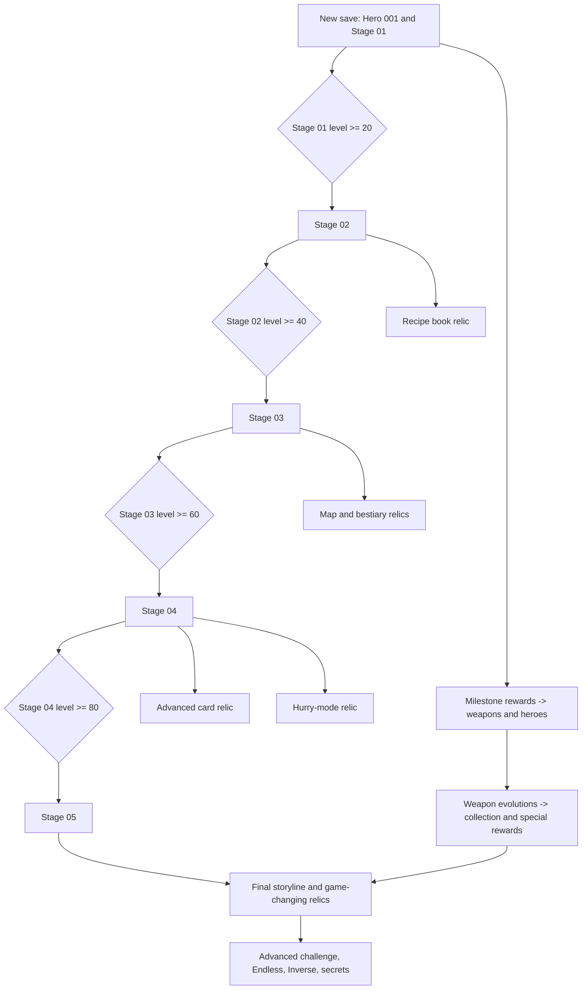
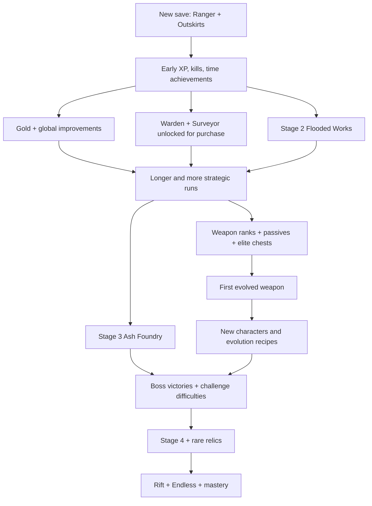

# A Vampire Survivors–Style Game: One-for-One Systems & Progression Template

**Reference architecture, implementation specification, and research compendium**  
**Prepared:** November 10, 2026  
**Primary reference:** *Vampire Survivors* (core/base-game progression; not an attempt to reproduce all expansions)  
**Secondary comparisons:** *Brotato*, *Halls of Torment*, *Deep Rock Galactic: Survivor*, *20 Minutes Till Dawn*, *Soulstone Survivors*, *Death Must Die*.

> **Interpretation:** You mentioned “Vampire's Fire”; given our earlier discussion I interpret that as *Vampire Survivors*. This document covers its core structure in unusually close detail, then gives you an original, swappable implementation template. It is **not** a source-code extraction or a claim that unknown hidden formulas are exact. Use your own character names, art, writing, sounds, ability identities, and branding.
>
> **Notation:** **[VS VERIFIED]** = a publicly documented behavior of *Vampire Survivors*; **[REPLICA RULE]** = the rule to use to obtain an equivalent experience; **[TUNABLE]** = illustrative balancing data, not an actual VS constant; **[OPTIONAL]** = later expansion.

## Navigation

- **Part A — Structure:** core loops, starting save, first session, screens, stage ladder, hero roster, weapons, draft rules.
- **Part B — Progression:** five-stage unlock graph, hero conditions, passive/evolution recipes.
- **Part C — Economy and Runs:** real VS shop rules, gold sources, 30-minute wave pacing, XP/loot, 70 achievement examples.
- **Part D — Advanced Systems:** permanent relics, Arcanas, Hyper/Hurry/Inverse/Endless, secrets and collection.
- **Part E — Implementation:** JSON schemas, TypeScript-style pseudocode, 40+ acceptance tests, developer tickets, AI coding prompt.
- **Part F — Sources:** source-by-source mechanic links and clear distinctions between verified and proposed values.
- **Part G — Previous Genre Analysis:** complete appended comparative report, including alternate game-design options.

## How to use this document with a coding AI

1. **Implement the `REPLICA RULE` lines as your baseline.** Preserve the progression gates, interface flow, economy roles, event types, slot counts and stage timing.
2. **Replace every `Your Game` name and every example ability/enemy** with your own content. The data schema should not require code changes when abilities change.
3. **Do not copy the sample enemy wave counts, damage numbers, or payout targets as proven Vampire Survivors values.** They are explicit placeholders pending playtesting and/or direct frame-data measurements.
4. **Build systems in the order in Section 22.** Test unlock/persistence first; do not fill out 50 characters until the core loop is complete.
5. **Keep the companion genre analysis appended at the end**: it explains why these systems sustain replayability and where other games make different choices.

---

# PART A — THE STRUCTURE TO REPLICATE

## 1. The exact architecture in one page

### Five nested loops

| Loop | Player action | State produced | State retained after death? |
|---|---|---|---|
| 0.5–5 seconds | Move, auto-attack, dodge, break objects, pick up gems | Position, damage, enemies, on-ground items | No |
| 15–90 seconds | Earn XP, select 1 of 3/4 upgrade cards | Build, levels, weapons/passives, combat stat changes | No |
| 1–30 minutes | Survive scheduled enemy waves, defeat special enemies, claim chests, evolve abilities | Gold, milestones, relic findings, stage-clear progress | Some |
| Between runs | Review summary, spend gold, buy eligible heroes, choose stage, observe unlocks | Persistent character roster, account PowerUps, stage/mode access | Yes |
| 10–100+ runs | Complete achievements, collections, secrets, challenge modes, character challenges | More options and new mechanics | Yes |

**[VS VERIFIED]** A new save starts with Antonio, Whip, and Mad Forest as the playable baseline. Other early characters (Imelda, Pasqualina, Gennaro) can already be unlocked for purchase; **only Antonio is owned/free at the start**. Main-stage access in the original progression comes from reaching **levels 20, 40, 60, and 80** in successive prior stages; reaching a full normal stage's **30-minute** time limit is not required to open the next standard stage. [Sources: Characters, Inlaid Library, Dairy Plant, Gallo Tower, Cappella Magna; see Sources.]

**[REPLICA RULE]** Every run must remain valuable even if the player dies, because account-level achievements are tracked from *events that happened before death* and currency earned is retained. Never require a deliberate loss: a skilled player can clear the first stage on their first attempt.

### The player-facing promise

- *Every fight* creates XP and positioning decisions.
- *Every few levels* changes the build.
- *Every elite chest* might upgrade an item or dramatically evolve a weapon.
- *Most early attempts* earn new gold, a progression milestone, or both.
- *A new stage* introduces a fresh layout and different enemy waves.
- *A new character* starts with a different core weapon or rule.
- *A major relic* unveils a system previously absent from the UI.
- *Completion* opens challenge modes rather than removing incentives to play.

## 2. Starting save state — one-to-one profile

| Domain | *Vampire Survivors* reference | Your game: implement this state |
|---|---|---|
| Owned characters | Antonio only | Hero 001 owned and selected |
| Selectable but not owned | Imelda (10 gold base), Pasqualina (100), Gennaro (500) | 3 additional heroes visible and purchasable immediately at low/mid/high cost |
| Stage access | Mad Forest | Region 01 only |
| Current active weapons | Antonio starts with Whip | Hero 001 begins with your starter attack, rank 1 |
| Weapon/passive inventory | Standard maximum 6 weapon slots, 6 passive slots | Exactly 6 + 6 |
| Starting gold | 0 | 0 |
| Main menu features | Start, character selection, PowerUps, Unlocks/collection components as accessible | Start, PowerUps, Unlocks, Options; hide advanced menus until earned |
| Arcanas | Unavailable until Randomazzo relic | Card/modifier system is not yet shown or selectable |
| Stage map/bestiary/grimoire | Earned from their corresponding relics | No map, monster book, or evolution recipe book at first |
| Purchases | Gold used for characters and global PowerUps | Shared wallet funds characters and permanent account stat ranks |
| Death | End of temporary build; permanent rewards/unlocks remain | Reset all run state; persist gold, unlocks, purchases, records |
| 30-minute limit | Normal main stages typically end at 30:00 with a Reaper/death event | At 30:00, record a stage clear, invoke final survival ending, transition to result screen |

**Character purchasing fidelity:** Starting heroes are **available to buy**, not necessarily “unlocked by dying X times.” That distinction creates early freedom and a low-cost first purchase, while later heroes require an achievement plus gold. A representative cost system from the wiki is `effectiveHeroPrice = min(basePrice * (1 + 0.10 * charactersAlreadyPurchased), priceCap)`; choose a consistent integer-rounding policy. This is **additive 10% of the base price per already purchased hero**, not compound growth by 10% of the most recent price. [Source: Characters.]

### Suggested exact starting flow

```text
NEW SAVE
  -> MAIN MENU [Start / PowerUps / Unlocks / Options]
  -> START
  -> CHARACTER SELECT
       Hero 001: OWNED (default)
       Hero 002: BUY 10 gold
       Hero 003: BUY 100 gold
       Hero 004: BUY 500 gold
       remaining heroes: hidden or silhouettes / view prerequisites
  -> FIRST STAGE SELECT (only Region 01)
  -> RUN
  -> DEATH OR 30:00 STAGE CLEAR
  -> RESULTS (time, level, kills, gold, new unlocks)
  -> MAIN MENU
  -> POWERUPS OR CHARACTER PURCHASE
  -> SELECT HERO/STAGE AND REPEAT
```

## 3. The first session: a faithful *sequence of systems*, not a scripted failure

### Before first run

- Show a small character roster; Hero 001 is ready, the next three tease different playstyles and prices.
- A single main stage is open. Do not display the advanced world map, cards, challenge modes or endless modes as if already functional.
- Give direct movement instructions only; normal attacks activate automatically.
- No equipment screen, no skill trees, no crafting station, no quest NPC hub required.

### During first run

| Target time | Expected player experience | Technical trigger |
|---|---|---|
| 0:00 | Control Hero 001; starter weapon fires automatically | `RunStarted` -> equip weapon rank 1 |
| First seconds | Weak enemies move toward player; some drop XP | `EnemyDied` -> XP gem |
| First level-up | Game pauses; choose 1 of 3 or 4 upgrade options | `XPThresholdReached` |
| 1:00 | Survival unlock and early distinctive enemy / elite event | `TimeReached(60)`; unlock passive class |
| 2–5 min | New weapon/passive options begin forming a build | Level-up drafts filtered by slots/pool |
| Any death | Result screen pays earned gold, permanently recognizes achievements | `RunEnded` -> commit event-derived rewards |
| If player survives | More waves/elite chests, and later weapon evolution | Wave director; chest eligibility resolver |
| 10:00+ | On typical stages, later elite chests can evolve eligible weapons | `ChestOpened` + `canEvolve` |
| 20–30 min | Dense enemy pressure; player may evolve several weapons | Timeline and pool permit late-run power fantasy |
| 30:00 | Normal stage is registered as survived/cleared and ends via Reaper-style climax | `StageTimerCompleted` |

**Important accuracy note:** In *Vampire Survivors* normal stage clears can end with the Reaper killing the character. **Death and victory are not mutually exclusive** in the data model: `stageClear = true` if the stage timer is completed, even if the final screen describes the character's death.

### Post-run priority rules

1. Award all *earned* currency and achievement completions exactly once.
2. Unlock newly eligible shop entries, content, stages and relic systems.
3. Show a concise reward summary: **Gold +X**, **New weapon**, **Character now available for purchase**, **Stage unlocked**.
4. Offer “PowerUps” and “Start” as obvious next actions.
5. Never wipe earned rewards because the player died early.

## 4. The game's screens, menus and button flow

| Screen | Needed functionality | First session? | After special unlock? |
|---|---|---:|---:|
| Main Menu | Start, PowerUps, Unlocks, Options | Yes | No |
| Character Select | Portrait, name, start weapon, stats, owned/available/locked, buy action | Yes | No |
| Stage Select | Stages, description, timer, gold/XP modifiers, locked state | Yes | No |
| PowerUps | Account-wide stats, remaining gold, buy rank, refund/reallocate | Yes | No |
| Combat HUD | HP, XP bar, level, clock, kills/gold if desired, six weapon and passive icons | Yes | No |
| Level-up Overlay | 3/4 randomized legal options and Reroll/Skip/Banish if earned | Yes | No |
| Pause | Resume, info, Quit/end run; inventory and stats | Yes | No |
| Treasure Chest | Reward reveal; level grant / evolution; gold feedback | Yes | No |
| Result Screen | Survived time, level, kills, gold, damage, new unlocks | Yes | No |
| Unlocks | Goal list, progress, completed rewards and previews | Yes | No |
| Collection | Item/evolution encounter history and completion | Early or unlockable | No |
| Evolution Grimoire | Discovered and undiscovered recipes | No | Yes: relic |
| Map | Stage pickups and points of interest | No | Yes: relic |
| Bestiary | Defeated enemy compendium | No | Yes: relic |
| Arcana Selection | Choose build modifier at run start and later miniboss chest | No | Yes: relic |
| Mode Select | Hyper, Hurry, Inverse, Endless variants | No | Yes: related milestones/relics |
| Secrets | Special challenge clues, hidden unlock conditions | No | Yes |
| Limit Break | Continued weapon upgrades after normal level caps | No | Yes |

A faithful feeling depends on these menu transitions as much as the combat itself. The loop back to the shop and clear goals after death is a core engagement component.

---

# PART B — CONTENT PROGRESSION: STAGES, HEROES, WEAPONS, ACHIEVEMENTS

## 5. Primary stage ladder (VS-derived)

| Order | VS reference stage | VS unlock condition | Your stage slot | Required structural difference |
|---|---|---|---|---|
| 1 | Mad Forest | Available immediately | **01: Open field** | Free-roaming open area; weak pursuers; environmental breakables; first relic/collectibles later |
| 2 | Inlaid Library | Reach **level 20** in Mad Forest (a single run) | **02: Horizontal corridor** | Constrained vertical space and left/right enemy approaches; 1–2 unique floor items |
| 3 | Dairy Plant | Reach **level 40** in Inlaid Library | **03: Maze/facility** | More hazards, choke points, environmental obstacles, new relic/navigation incentive |
| 4 | Gallo Tower | Reach **level 60** in Dairy Plant | **04: Vertical passage** | Long vertical navigation, special side locations; advanced relics |
| 5 | Cappella Magna | Reach **level 80** in Gallo Tower | **05: Climactic arena** | Final core-stage content, unique elite/boss rules and higher-stakes secrets |

**[VS VERIFIED]** These four level-gate numbers, stage sequence and standard 30-minute limits are public documentation of the base progression. They are **not** an approximation. The original stages also have individual gold multipliers and special modifier values; copy the *roles* of their modifiers, not necessarily their numeric constants. [Sources: individual stage wiki articles.]

**[REPLICA RULE]** Unlock the next stage as soon as the threshold is reached—even if the player dies seconds later. Do not replace level gates with defeating the previous stage's 30-minute final enemy. This is an important progression distinction.

### Stages are both destinations and content distribution channels

Each stage should define:

```text
stageId
stageTitle
geometry: open | horizontal | maze | vertical | special
runDurationSeconds = 1800
startingEnemyPool[]
waveTimeline[]
eliteTimeline[]
relicLocations[]  // saved as acquired after first collection
floorPassiveLocations[]
characterCoffinLocations[]
destructibleObjectTable[]
baseModifiers: enemyHP, enemyMoveSpeed, playerMoveSpeed, pickupRate, goldGain
hyperModeModifiers
stageClearReward
unlockPrerequisite
```

**[VS VERIFIED]** Real stages include stat modifiers, fixed stage passives, hidden collectibles, coffins that can unlock characters, stage-specific enemy distributions and optional Hyper modes. Relics are one-time pickups. [Sources: Passive items, Relics, Stages.]

### Main stage vs bonus/challenge stage

Do not make 10 linear 30-minute campaigns. Use a **5-stage primary spine**, then unlock optional shorter or stranger stages that teach a specific mechanic (fast gold, boss gauntlet, randomized enemies, limited movement, rare item farming). This recreates the feeling of primary, bonus and challenge stage categories without needing to reproduce every official map.

## 6. Stage unlock graph and secondary systems



**[REPLICA RULE]** Treat this as a **dependency graph**; a player can acquire relics in different orders if they navigate creatively. Do not hard-code a strict sequence of runs or deaths.

## 7. Hero roster: faithful unlock roles

### Verified early hero baselines

| VS character | Starting weapon | Unlock/purchase behavior | Core identity |
|---|---|---|---|
| Antonio | Whip | Free/default | More Might every 10 levels up to cap; extra HP/armor |
| Imelda | Magic Wand | Buy from start, base **10 gold** | More experience per five levels up to cap |
| Pasqualina | Runetracer | Buy from start, base **100 gold** | Increasing projectile speed as she levels |
| Gennaro | Knife | Buy from start, base **500 gold** | +1 Amount globally; extra HP |
| Arca | Fire Wand | Reach Fire Wand rank **4**, then buy (base 500) | In-run cooldown improvement |
| Porta | Lightning Ring | Reach Lightning Ring rank **4**, then buy (base 500) | Large early cooldown effect, area specialty |
| Poe | Garlic | Raise Garlic to rank **7**, then buy (base 500) | Pickup proximity / protective area at lower HP |
| Clerici | Santa Water | Heal **1,000 lifetime HP**, then buy | Recover/area specialty |
| Dommario | King Bible | Earn **5,000 gold in one run**, then buy | Duration/projectile specialization with slower movement |
| Lama | Axe | Survive **20 minutes** with sufficient Curse | Increased reward/danger tradeoff |
| Mortaccio | Bone | Defeat **3,000 skeletons cumulatively**, then buy | Increases projectile Amount every 20 levels |

**[VS VERIFIED]** The unlock gates above mirror documented original base-game character progression. Prices listed are **base prices**, before the cross-character purchase modifier. [Sources: Characters, Achievements, individual character articles.]

### Original game roster slots to populate with your own heroes

| Your hero | Available when | Starting ability | Behavioral identity | Price role |
|---|---|---|---|---|
| Hero 001: The Survivor | default, owned | Your melee/short-range basic attack | More damage as level rises | free |
| Hero 002: The Scholar | purchasable at start | Nearest-enemy smart shot | Better XP gain | very cheap |
| Hero 003: The Scout | purchasable at start | Ricocheting projectile | Faster projectile motion | cheap |
| Hero 004: The Hunter | purchasable at start | Facing-direction rapid shot | +1 projectile | early aspirational |
| Hero 005: The Ember | Get Fire ability rank 4 | Heavy random-target blast | Gradual cooldown reduction | mid |
| Hero 006: The Storm | Get Lightning ability rank 4 | Distributed strike | Area specialist | mid |
| Hero 007: The Guard | Get aura ability rank 7 | Nearby persistent damage | Pickup/defense tradeoff | mid |
| Hero 008: The Healer | Recover 1,000 lifetime HP | Ground-zone attack | Recovery and large temporary area | mid |
| Hero 009: The Keeper | Get 5,000 gold in a single run | Rotating effect | Duration vs movement-speed tradeoff | mid |
| Hero 010: The Cursed | Survive 20 minutes with +10% enemy pressure | Heavy arc strike | Higher risk / higher reward | mid |
| Hero 011: The Bonesmith | Kill 3,000 designated enemy family across runs | Multiple small projectiles | Extra shots at level milestones | mid |
| Hero 012: The Hidden | Complete a special in-world condition | Unusual weapon or rule | A discovery prize | secret |

These **are placeholder titles, not content you have to use**. Preserve only the structural functions. If you already have original abilities, map each to a comparable role.

### Character contract

Every character has exactly:

1. `startingWeaponId` (unless special rule explicitly overrides it).
2. `baseStatModifiers`, additive/multiplicative and capped as appropriate.
3. `perLevelTrait` or a meaningful static identity.
4. `unlockRule`, `baseGoldPrice`, `purchased` state.
5. `portrait`, `model`, `name`, `description` (owned by your game).

A new hero is **not** just a stronger version of the previous hero; it is a different starting constraint with a different optimal build.

## 8. Weapon and passive inventory: exact broad rules

- **[VS VERIFIED]** Standard inventory: **six weapons and six passive items** (most late-game extensions change limits in special ways). [Source: Level up.]
- **[VS VERIFIED]** Many base weapons have **eight levels** and many normal passives **five**; exceptions exist (e.g. Duplicator only two levels). [Sources: Weapons, Passive items.]
- **[VS VERIFIED]** On XP level-up the game pauses and offers **three or four** nonduplicate legal selections, except when the pool is exhausted. [Source: Level up.]
- **[VS VERIFIED]** Six passive slots is the **ordinary level-up draft cap**; certain fixed passives lying on the stage can still be collected **after** six drafted passives, yielding more than six total. The usual strategy is to fill the six drafted slots first, then take the map passives. Model floor-item acquisition separately from the normal draft-slot restriction. [Source: Passive items.]
- **[VS VERIFIED]** New item adds a slot, existing item goes to its next rank; a fully maxed item is excluded from future ordinary drafts. When no standard upgrade remains, coin/healing rewards appear; later Limit Break can instead grant extra weapon growth. [Source: Level up.]
- **[REPLICA RULE]** Start with six slots of each type, many 8-rank base weapons, and 5-rank passive items. Do **not** use the earlier exploratory 4+4/6-rank design from the appended genre note for this one-to-one version.

### A faithful set of attack *roles* (place your own abilities in these slots)

| Slot | VS weapon reference | Attack behavior to emulate with your own content | Base rank cap | Intended evolution requirement |
|---|---|---|---:|---|
| W01 | Whip | Alternating directional horizontal cleave | 8 | Max weapon + max-HP passive owned |
| W02 | Magic Wand | Automatic nearest-target bolt | 8 | Max weapon + cooldown passive |
| W03 | Knife | Repeated shots in last-facing direction | 8 | Max weapon + projectile speed passive |
| W04 | Axe | Slow large high-damage arc/drop | 8 | Max weapon + area passive |
| W05 | Cross | Seeking boomerang/returning projectile | 8 | Max weapon + luck passive |
| W06 | King Bible | Moving orbit of damaging projectiles | 8 | Max weapon + duration passive |
| W07 | Fire Wand | Heavy projectile fired toward a random target | 8 | Max weapon + damage passive |
| W08 | Garlic | Continuous very close-range damage field | 8 | Max weapon + health regen passive |
| W09 | Santa Water | Persistent damaging zones on the ground | 8 | Max weapon + pickup-radius passive |
| W10 | Runetracer | Straight-traveling bouncing projectile | 8 | Max weapon + armor passive |
| W11 | Lightning Ring | Distributed automatic lightning on enemies | 8 | Max weapon + +projectile-count passive |
| W12 | Pentagram | Periodic screen-clearing effect with drawback | 8 | Max weapon + XP-growth passive |
| W13 | Peachone | Rotating projectile barrage, first half of union | 8 | Max both companion weapons |
| W14 | Ebony Wings | Complementary rotating barrage, second half | 8 | Max both companion weapons |

**Important:** The above maps design *functions*, not a requirement to recreate exact visuals, effects, or names. Your different abilities can fill equivalent mechanical roles.

### Generic eight-rank weapon growth pattern [TUNABLE]

| Rank | Type of change | Example |
|---|---|---|
| 1 | Establish attack pattern | One slash, shot, aura, orbit or zone |
| 2 | Add quantity or coverage | +1 projectile or +radius |
| 3 | Increase damage | +flat damage |
| 4 | Increase damage or area | +damage, better duration |
| 5 | Increase damage | +flat damage |
| 6 | Improve pattern parameter | +area, +quantity or -cooldown |
| 7 | Increase damage or utility | +damage or hit behavior |
| 8 | Maximum weapon rank | Final numerical improvement; now evolution-eligible |

The original does not apply one identical rank sequence to all weapons. Store rank deltas **per weapon**, not one global progression formula.

## 9. Passive items and evolution dependency graph

| Your passive role | VS reference passive | Typical max rank | What it grants | Evolution synergy |
|---|---|---:|---|---|
| P01 | Hollow Heart | 5 | More maximum HP | Directional cleave |
| P02 | Empty Tome | 5 | Less cooldown | Nearest-target bolt |
| P03 | Bracer | 5 | Projectile speed | Facing-direction volley |
| P04 | Candelabrador | 5 | Attack area | Heavy arc attack |
| P05 | Clover | 5 | Luck | Boomerang/critical attack |
| P06 | Spellbinder | 5 | Effect duration | Orbiting attack |
| P07 | Spinach | 5 | More damage | Heavy random-target blast |
| P08 | Pummarola | 5 | Health regeneration | Close-range aura |
| P09 | Attractorb | 5 | Pickup radius | Ground-zone attack |
| P10 | Armor | 5 | Less incoming damage | Bouncing projectile |
| P11 | Duplicator | 2 | +projectile Amount | Distributed lightning |
| P12 | Crown | 5 | More XP | Screen-clearing attack |
| P13 | Wings | 5 | Move speed | Utility / future expansion |
| P14 | Stone Mask | 5 | Gold gain | Economy build |

**[VS VERIFIED]** Many notable VS weapon evolutions match these exact pairings; standard evolution requires maxing the base weapon, owning the appropriate passive and opening an eligible chest. **The passive does not normally have to be maxed** for classic evolutions, but some later and special evolutions require maxed passives. [Source: Evolution.]

### Reference evolution matrix (for designers, not asset duplication)

| VS base weapon + companion passive | VS evolved weapon | Mechanical upgrade concept for your game |
|---|---|---|
| Whip + Hollow Heart | Bloody Tear | Better cleave with critical/life-steal behavior |
| Magic Wand + Empty Tome | Holy Wand | Near-continuous focused automatic fire |
| Knife + Bracer | Thousand Edge | Sustained facing-direction stream |
| Axe + Candelabrador | Death Spiral | High-damage wide-reaching outward projectiles |
| Cross + Clover | Heaven Sword | Stronger returning strikes / critical behavior |
| King Bible + Spellbinder | Unholy Vespers | Permanent rotating barrier |
| Fire Wand + Spinach | Hellfire | Heavy piercing fire attack |
| Garlic + Pummarola | Soul Eater | Stronger aura integrated with life/health interaction |
| Santa Water + Attractorb | La Borra | Large merging damaging ground zones |
| Runetracer + Armor | NO FUTURE | More violent bouncing/exploding shots |
| Lightning Ring + Duplicator | Thunder Loop | Repeated lightning strike pattern |
| Pentagram + Crown | Gorgeous Moon | Stronger sweeping kill/XP collection effect |
| Peachone + Ebony Wings (both max) | Vandalier | Union of two barrage weapons; frees a weapon slot |

**[VS VERIFIED]** These are actual reference pairings from the base-game evolution list. [Source: Evolution.]

### Evolution resolver order

```text
on ChestOpened(chest):
  1. Check chest.evolutionEligible.
  2. For every active, unevolved weapon, test all evolution recipes:
        - required base weapon exists
        - required base weapon is max rank
        - required passive item exists
        - any special passive-rank requirement is met
        - required secondary weapons are max rank (unions)
        - output isn't banned/illegal
  3. If any eligible recipe exists, choose according to deterministic policy.
  4. Replace base weapon with evolved result, normally maintaining slot occupancy.
  5. For union: remove both base weapons, grant union; one slot becomes free.
  6. Grant ordinary chest upgrades and gold as the chest tier permits.
  7. Emit WeaponEvolved/WeaponUnited; unlock collection history and linked goals.
```

**[VS VERIFIED]** Evolution-bearing chests **usually** arrive from bosses after the **10:00** mark, but specific early chests (including the 1:00 Mad Forest Glowing Bat) and certain stages are exceptions. There is **usually one evolution per chest**, with explicit special multi-evolution exceptions. Make chest eligibility **data-driven per boss/chest**, rather than checking `time >= 600` globally. [Sources: Evolution, Treasure Chest.]

### Treasure chest grades

- `NORMAL_1`: one eligible item upgrade/evolution and a gold reward.
- `RARE_3`: three item rewards or upgrade grants; appropriate presentation and sound flourish.
- `RARE_5`: five item rewards/upgrades; spectacular reveal and gold payout.
- `ARCANA`: special modifier selection; not the same as a routine chest.

**[VS VERIFIED]** Treasure chests can award 1, 3, or 5 rewards, are normally dropped by strong enemies and have quality influenced by Luck. [Sources: Treasure Chest, Pickups.]

## 10. Level progression and draft rules

### Experience thresholds

**[VS VERIFIED]** The reference game starts at level 1 and needs **5 XP** for level 2. The required XP then grows by **10 per level** through level 20; the slope becomes **+13** in the level 21–40 range and **+16** thereafter. Special large XP requirements occur at the level-20 and level-40 transitions, accompanied by a temporary growth boost. These breakpoints are important to the run's perceived early/middle/late progression. [Source: Level up.]

**[REPLICA RULE]** You can either implement this breakpoint-shaped XP curve with its special spike rules, or author an explicit XP requirement table validated against the wiki. Do not use one exponential multiplier from level 1 to level 200; it produces a notably different run cadence.

### Draft algorithm

```text
candidatePool = all content the player has unlocked for this save
for each candidate:
  if weapon: offer as new only when weaponSlotsUsed < 6
  if passive: offer as new only when passiveSlotsUsed < 6
  if currently owned: offer only if rank < maxRank
  if sealed/banished: exclude
  if item is stage-only, special or incompatible: exclude unless explicit override
  apply candidate rarity/weight and available-run modifiers
roll 3 or 4 UNIQUE legal options (no duplicates within a draft)
if no upgrades possible:
  if LimitBreak enabled: draft eligible weapon limit-break upgrades
  else: offer gold or healing rewards
pause combat simulation until choice is made
apply chosen delta
brief post-selection safety window as appropriate
```

**[VS VERIFIED]** Reroll rerandomizes a draft, Skip sacrifices that draft for XP, and Banish removes a selected item from further leveling offers. The counts come from appropriate PowerUps/milestones. [Sources: Level up, Skip, Banish.]

### Draft quality assurance rules

- Owned but incomplete items are eligible; maxed items are not.
- Newly unlocked content must become eligible for future **runs**; do not retroactively modify a current run's pool unless intentional.
- An item cannot appear twice on the same draft screen.
- A player with six weapons can still upgrade those weapons but cannot receive a seventh ordinary weapon.
- An eligible evolution is **not** offered in a normal level-up draft; it comes from an eligible chest.
- At full inventory with everything maxed, the game must not enter a dead-end pause.
- Banishing an item should not corrupt owned inventory or prevent relic persistence.

---
# PART C — EARNINGS, META POWERUPS, ENEMIES, RUNS

## 11. Permanent economy: gold is persistent, XP isn't

### Currency roles

| Resource | Collected from | Used for | Reset on death? | Character-specific? |
|---|---|---|---|---|
| XP gems | Defeated enemies and some effects | Raise **this run's** hero level | Yes | No |
| Gold coins / coin bags | Destructibles, pickups, chests and special mechanisms | Purchase heroes and account PowerUps | No | No |
| Chests | Strong/boss enemies | Rank upgrades, evolution and coin rewards | Consumed on open | No |
| Permanent achievement progress | Events: survival seconds, kills, healing, evolved items, level milestones | Unlock content and new menus | No | Sometimes |
| Relics | One-time specific map positions / major bosses | Turn on a permanent game feature | No | Usually account-wide |
| Golden eggs [OPTIONAL] | Late-game shops/bosses | Tiny permanently growing **per-character** stat bonuses | No | Yes |

**[VS VERIFIED]** Gold purchases account PowerUps and heroes. In-run XP is separate and restarts each attempt. The core game has additional late-game farming systems, but they are not necessary for the introductory loop. [Sources: PowerUps, Characters, Pickups.]

### A faithful *store architecture*

1. **Character store:** Each hero has `status = LOCKED | UNLOCKED_UNPURCHASED | OWNED`. Some are `UNLOCKED_UNPURCHASED` from the very beginning.
2. **Global PowerUps:** Account-wide ranks that affect all heroes, including those not yet bought.
3. **Refund All:** Refund all spent account PowerUp currency, reset those ranks, leave heroes and other content permanently unlocked. **Do not** refund purchased heroes unless your game explicitly adds a separate service.
4. **Independent progression:** A player can postpone buying characters and max selected meta stats; or buy a roster early and make each run mechanically different.
5. **A currency sink at endgame:** Optional golden-egg / per-character investments only after ordinary rank caps and significant account progress.

### Publicly documented Vampire Survivors PowerUps baseline

| Shop stat | Base price (gold) | Max ranks | Per-rank effect | Purpose |
|---|---:|---:|---|---|
| Might | 200 | 5 | +5% damage | Core DPS |
| Armor | 600 | 3 | -1 incoming hit damage | Safety |
| Max Health | 200 | 3 | +10% max HP | Safety |
| Recovery | 200 | 5 | +0.1 HP/s | Attrition control |
| Cooldown | 900 | 2 | -2.5% weapon cooldown | High-value offense |
| Area | 300 | 2 | +5% attack area | Crowd control |
| Speed (projectile) | 300 | 2 | +10% projectile speed | Projectile scaling |
| Duration | 300 | 2 | +15% duration | Zones/orbits |
| Amount | 5,000 | 1 | +1 projectile | Major spike |
| Move Speed | 600 | 2 | +5% movement speed | Positional skill |
| Magnet | 300 | 2 | +25% pickup radius | XP economy |
| Luck | 600 | 3 | +10% luck | Chance-based rewards |
| Growth | 900 | 5 | +3% XP gain | XP economy |
| Greed | 200 | 5 | +10% coin gain | Meta economy |
| Curse | 1,666 | 5 | +10% enemy pressure | Deliberate risk toggle |
| Revival | 10,000 | 1 | +1 revive | Recovery |
| Omni | 1,000 | 5 | +2% to several attack stats | Advanced hybrid |
| Reroll | 1,000 | up to 5 | +2 draft rerolls | Build control |
| Skip | 100 | up to 5 | +2 level-up skips | Build control |
| Banish | 100 | up to 5 | +2 banishes | Build control |

**[VS VERIFIED]** The prices/effects are from the current publicly documented PowerUps table. Several later additions (Charm, Defang, Preserve, Seals and others) are omitted from this starter reference; some rank maxima require unlocking achievements. [Source: PowerUps.]

### The base-game shop cost formula

Public wiki formula for a new purchased rank:

```text
baseCost = initialPrice * (1 + ranksAlreadyOwnedForThisPowerUp)
if totalPowerUpRanksPurchasedAcrossAllTypes == 0:
    fee = 0
else:
    fee = floor(20 * 1.1 ^ totalPowerUpRanksPurchasedAcrossAllTypes)
rankCost = baseCost + fee
```

**[VS VERIFIED]** The modern formula makes shop prices depend on owned ranks of the specific power-up **and** the number of already purchased PowerUp ranks across the shop; the once-important purchase-order optimization changed in June 2022. Refund/redistribution is possible. [Source: PowerUps.]

**[REPLICA RULE]** Use this pricing function if your goal is close mechanical similarity. If you want easier economic balancing, a simpler shop formula can be substituted only after your basic version is working; it will produce a meaningfully different progression curve.

### The actual gold payout system vs our placeholder

**Do not present a simple `kills × 0.06 + minutes × 4` formula as Vampire Survivors' internal gold calculation.** That was our earlier original illustration, not a reverse-engineered game rule. In the reference, gold primarily comes from item drops, light-source/destructible pickups, chests and other effects; greed/stage/mode bonuses modify collection. [Sources: Pickups, Treasure Chest, PowerUps.]

**[REPLICA RULE]** Implement gold primarily as *collected physical rewards*, not an automatic minute-survived payout. If you want a small participation guarantee, label it as a **your-game change**.

Recommended **[TUNABLE]** source budget for testing, not a VS claim:

| Source | Baseline behavior | Suggested first-pass tuning objective |
|---|---|---|
| Destructible object | Drop weighted healing, coin, coin bag, temporary effect | One helpful breakable every 20–45 seconds of travel |
| Regular enemy | Primarily XP; rare secondary coin | Gold should not flood from every kill |
| Elite enemy | Guaranteed or high-probability chest | One reward spike at authored milestones |
| Chest | One or more rank rewards and a coin amount | Most visible money spikes until stronger farm builds |
| Special gold pickup | Extra coin amount | Feels meaningfully more lucrative than normal coin |
| Stage multiplier | Modifies collectible currency | Later stages and Hyper feel more profitable |
| Global Greed | +gold percentage | Long-term investment in farming |
| Gold fever [OPTIONAL] | Time-limited cascade from coin collection | Late-game farming/build incentive |

### Early-economy acceptance tests

- The cheapest alternate hero should be affordable **after one ordinary early run**, even if it ends unsuccessfully.
- A second affordable PowerUp choice should usually be accessible early; both shop paths compete for money.
- Early meta buying must help, but not be so strong that every player is expected to grind five losses before surviving ten minutes.
- A player reaching a later stage should have access to more gold opportunities, but not necessarily receive a mandatory fixed completion salary.
- No save loss on exiting after results.
- Spending the last coin must never prevent starting another run.

## 12. The five-stage, thirty-minute wave director

The real stages have their own enemy-wave tables; the following is **[TUNABLE] authored reference behavior** designed to reproduce pacing, not a published transcription of all actual minute-by-minute spawn counts. **Use it to implement the wave scheduler with your enemies.**

### Global timing and intensity bands

| Minute | Combat rhythm | New enemy design requirement | Important event / intention |
|---|---|---|---|
| 00 | Slow, few and readable | Basic pursuer A | Learning and first level-up |
| 01 | Light swarm, distinctive elite | Basic A + small weak flier | Early elite/chest; first survival unlock |
| 02 | Slightly faster pressure | Add fast-but-weak pursuer | Player chooses second attack/passive |
| 03 | Medium swarm | Mixed A/B | Greater XP density |
| 04 | Brief high-density mob | Small low-HP swarm | Area weapon becomes appealing |
| 05 | Respite with dangerous elite | A + tanky elite | Chest / stronger reward moment |
| 06 | Rapid target variety | Introduce high-HP slow enemy | Weapon choice matters |
| 07 | Dense chase | Existing families with different speed | First real mobility test |
| 08 | Wave of small enemies | Large pack of fragile units | XP opportunity / power-feeling beat |
| 09 | Increasingly threatening mix | A+B+C | Transition toward evolve eligibility |
| 10 | Elite threshold | Mid-tier boss | Typical stage starts granting evolution-capable chests |
| 11 | Optional special modifier boss | Arcana-bearing elite when enabled | Optional second Arcana pick |
| 12 | Reset to new composition | Armor/knockback-resistant enemy | Prevent stale pure-DPS solution |
| 13 | Medium-heavy swarm | Rush enemy | More frequent evasive movement |
| 14 | Dense waves | Multiple shapes | XP for finishing weapon ranks |
| 15 | Noticeable spike | Mini-boss + rush enemies | Chest/evolution window |
| 16 | Temporary power fantasy | Weaker mass-spawn wave | Let evolved build feel extraordinary |
| 17 | Threat compression | New durable enemy | Require improvement not just standing still |
| 18 | High density | Mixed elite supports | Arena control |
| 19 | High density and rare chest | Resilient enemy family | Endgame readiness |
| 20 | Elite / chest burst | Wave boss | Reward fully developed builds |
| 21 | Optional second Arcana boss | Modifier-bearing boss | Third Arcana pick when enabled |
| 22 | Strong varied enemy waves | Faster high-HP opponents | Evaluate defensive holes |
| 23 | Sustained pressure | Attack-pattern enemy | Sustain / reposition |
| 24 | Brief lower-tension setup | Weaker enemies and one elite | Last build adjustment |
| 25 | Major named elite | Stage-specific boss | Hyper unlock candidate or chest |
| 26 | Difficult late wave | Big crowds + bruisers | Hard survival |
| 27 | Dense finale | One mixed high-threat family | Excitement rise |
| 28 | Almost overwhelming | Sustained surrounds | Defense and clear speed |
| 29 | Climactic crowd | Extreme wave; no trivial pause | Final survival test |
| 30 | Stage time limit | Reaper-style terminating hazard | Mark normal stage cleared, roll ending/results |

**[VS VERIFIED]** Normal main stages typically use **30 minutes**, a stage timer ending with a lethal Reaper-style pressure spike, and standard Arcana-bearing bosses at **11:00** and **21:00** after the Arcana system is unlocked. [Sources: Stages, Arcana.]

### Stage-specific directors

| Stage role | Geometry | Enemy roster variation | Hazard/loot flavor | Stage landmark |
|---|---|---|---|---|
| S1 Open field | Infinite-like scrolling plain | Slow baseline enemies, mass weak enemies, familiar elites | First destructible objects, healing and XP | Starter milestone and hidden character location |
| S2 Horizontal corridor | Constrained top/bottom | Fast converging corridor enemies | Stronger XP lanes, guaranteed map passive(s) | Evolution recipe book relic |
| S3 Maze/facility | Obstacles, cross halls | Mixed pursuer, rush, durable enemy | More light sources, bonus passive picks, new relics | Map + bestiary |
| S4 Vertical corridor | Narrow x, long y | New directional waves, flank attacks | Long-range exploration and special rooms | Arcana relic, Hurry relic |
| S5 Finale map | Large accessible sectors | Extreme waves, special bosses | Rare pickups, permanent story relics | Core stage finale |

### Stage-data design rule

Enemy spawn counts, families and HP should be specified in a **stage-owned data file**. Avoid a director that merely scales a single enemy type forever. Distinct wave identities are essential to the game feel.

**Example stage wave entry [TUNABLE]:**

```json
{
  "minute": 10,
  "durationSec": 60,
  "entries": [
    {"enemyId": "grunt_b", "spawnPerSecond": 3.5, "spawnWeight": 60},
    {"enemyId": "bruiser_a", "spawnPerSecond": 0.9, "spawnWeight": 25},
    {"enemyId": "sprinter_a", "spawnPerSecond": 1.2, "spawnWeight": 15}
  ],
  "bosses": [
    {"enemyId": "elite_m10", "atSec": 600,
     "dropChestId": "evolution_chest_m10"}
  ],
  "intensityLabel": "evolution_window"
}
```

**Notes:** The counts above are prototype placeholder values. For faithful stage timing, maintain the authored absolute `atSec` schedule; for Hurry, multiply game-clock speed rather than rescheduling every event manually.

## 13. XP, enemies, drops, projectiles and object pooling

### XP gem lifecycle

1. Enemy receives damage from an ability.
2. Enemy HP reaches zero -> `EnemyKilled` emitted with `enemyId`, `weaponId`, `position`, `time`.
3. Loot resolver creates an XP gem or adds XP to an existing gem cluster.
4. Gems sit in the world and can be collected later.
5. Entering magnet radius attracts gems toward the player.
6. Gem collection adds XP, applying Growth/stat modifiers.
7. Multiple level thresholds can be crossed; queue multiple **sequential** level-up screens, not simultaneous overlay stacks.
8. Periodic map-cleanup may consolidate distant gems without destroying their total XP value.

### Spawn lifecycle

- Use an offscreen annulus around the player; distribute from legal spawn directions.
- Reject invalid coordinates inside walls, in blocked tiles, or too close to the hero.
- Keep a hard cap on active monsters; if exceeded, reduce future spawn count or recycle low-priority entities rather than performing explosive allocations.
- Enemy base HP/speed/damage come from archetype + stage wave + Curse/mode overrides; avoid a hidden dynamic-difficulty function unless it is an intentional, documented feature.
- Distinct boss events override generic density and can drop identified chest types.

### Projectile/action system

Your ability engine can be custom, but every weapon must expose uniform values:

```text
damage, cooldown, amount, area, speed, duration, knockback,
criticalChance, pierce, targetingMode, spawnPattern, collisionPolicy,
statusEffects, tags, maxRank, rankUpgrades
```

**Required targeting modes:** nearest, random eligible target, movement-facing, orbit, autonomous area, bouncing/returning. **Required damage delivery modes:** projectile hit, persistent contact zone, pulse, periodic screen effect, status tick. This minimal set supports the structural variety of the game's opening weapons.

### Destructible-object system

**[VS VERIFIED]** Breakable light sources can grant XP-neutral pickups such as coins, coin bags, healing, Vacuum, freezing/time-stop effects and Rosary-like screen-clears. Several unlocks depend on **finding those pickups** or **breaking enough light sources**, rather than defeating enemy types. [Sources: Pickups, Achievements.]

**[REPLICA RULE]** Destructibles are not background decoration: make them part of progression and early discovery. Implement a stable weighted pickup table with run-level predicates. Keep 1–2 early achievement chains attached to their rewards.

### Scene performance expectations [TUNABLE engineering goals]

- Pool enemies, XP gems, projectiles, hit VFX and damage numbers.
- Use a broad-phase spatial grid for nearby enemy queries and projectile hits.
- Avoid physically simulating every XP gem and projectile at full complexity when far offscreen.
- Keep stable behavior at high enemy densities on low/mid-range hardware.
- Separate visible objects from gameplay entities to reduce rendering overhead.
- Instrument active entity count and frame time; expose developer overlay with spawned enemies, alive, culled, pooled and defeated.
- Keep lock-step event order for reliable reproducible unlock tests.

## 14. Account progression and achievement event design

### Required event types

```text
RUN_STARTED
RUN_ENDED
RUN_SURVIVED_SECONDS
STAGE_TIMER_COMPLETED
LEVEL_REACHED
WEAPON_RANK_REACHED
WEAPON_EVOLVED
WEAPON_UNION_CREATED
PASSIVE_RANK_REACHED
ITEM_OWNED_COUNT_REACHED
ENEMY_KILLED
ENEMY_FAMILY_KILLED
HEALTH_RECOVERED
GOLD_PICKED_UP
GOLD_RUN_TOTAL_REACHED
PICKUP_COLLECTED
DESTRUCTIBLE_DESTROYED
CHEST_OPENED
CHARACTER_BOUGHT
CHARACTER_RUN_COMPLETED
RELIC_PICKED_UP
COFFIN_OPENED
COLLECTION_ITEM_DISCOVERED
BOSS_DEFEATED
MODE_COMPLETED
```

### Scope and reset semantics

| Scope | Examples | Reset point |
|---|---|---|
| Single event | Pick up a Rosary-like pickup, acquire a relic | Never (event logged and applied) |
| Per run | Reach level 20 on stage 1; obtain 5,000 gold in one attempt | Reset at `RUN_STARTED` |
| Lifetime | Recover 1,000 total HP, kill 3,000 of enemy family | Never |
| Per character, per stage | Clear stage 3 with hero 6 | Never |
| Per inventory build | Have six different weapons simultaneously | Reset at each run |
| Per stage/mode | Survive 30 min in normal or Hyper mode | Never |

**Critical:** `lifetimeGold` is not `walletGold`; `goldCollectedThisRun` is not `walletGold`; `lifetimeHealing` is not `currentHP`. These are distinct counters. Distinguish attempts, purchases, collection history and achievements as separate persistent data.

## 15. A large unlock catalogue: faithful conditions, mapped to your own rewards

The first table lists **documented original conditions** you can treat as direct structural templates. The second table supplies **original extra** milestones for a full game after you've implemented the base ones. Names and original items are for reference only; assign your own reward IDs.

### VS-reference unlock list (core-game verified)

| # | Trigger in original | Original reward | Your reward slot / type |
|---:|---|---|---|
| 01 | Reach character level **5** | Wings | New movement passive in draft pool |
| 02 | Reach character level **10** | Crown | New XP-growth passive |
| 03 | Survive **1 minute** with anyone | Hollow Heart | New survivability passive |
| 04 | Survive **10 minutes** with anyone | Peachone | New weapon |
| 05 | Survive **20 minutes** with anyone | Pentagram | Special high-risk weapon |
| 06 | Destroy **20** light sources | Fire Wand | New weapon |
| 07 | Pick up **5** healing-food pickups | Garlic | Protective-area weapon |
| 08 | Find **1** Rosary | Cross | Returning weapon |
| 09 | Find **1** Orologion | Clock Lancet | Slow/freeze weapon |
| 10 | Find **1** Vacuum | Attractorb | Magnet/passive |
| 11 | Find **1** Little Clover | Clover | Luck/passive |
| 12 | Reach level **20** in Mad Forest | Inlaid Library | Open Stage 02 |
| 13 | Reach level **40** in Inlaid Library | Dairy Plant | Open Stage 03 |
| 14 | Reach level **60** in Dairy Plant | Gallo Tower | Open Stage 04 |
| 15 | Reach level **80** in Gallo Tower | Cappella Magna | Open Stage 05 |
| 16 | Survive **5 minutes** with Pasqualina | Runetracer | Starter hero's signature weapon becomes generally available |
| 17 | Survive **5 minutes** with Gennaro | Pummarola | Recovery passive |
| 18 | Get King Bible to rank **4** | Bracer | Projectile speed passive |
| 19 | Get Santa Water to rank **4** | Candelabrador | Area passive |
| 20 | Get Fire Wand to rank **4** | Arca | New character available to purchase |
| 21 | Get Lightning Ring to rank **4** | Porta | New character available to purchase |
| 22 | Get Magic Wand to rank **7** | Duplicator | Extra projectile passive |
| 23 | Get Peachone to rank **7** | Ebony Wings | Matching union weapon |
| 24 | Get Runetracer to rank **7** | Spellbinder | Duration passive |
| 25 | Get Garlic to rank **7** | Poe | New character available to purchase |
| 26 | Hold **6 different weapons** simultaneously | Empty Tome | Cooldown passive |
| 27 | Recover **1,000 lifetime HP** | Clerici | New character available to purchase |
| 28 | Earn **5,000 gold in a single run** | Dommario | New character available to purchase |
| 29 | Defeat **3,000 skeletons cumulatively** | Mortaccio | New character available to purchase |
| 30 | Survive **20 minutes** with enough Curse | Lama | Risk/reward character |
| 31 | Reach level **50** with Antonio | Arcana X — Beginning | Advanced modifier card |
| 32 | Reach level **50** with Imelda | Arcana XI — Waltz of Pearls | Advanced modifier card |
| 33 | Reach level **50** with Gennaro | Arcana VII — Iron Blue Will | Advanced modifier card |
| 34 | Find the Randomazzo relic | Arcana VI + Arcana menu | Unlock entire card system |
| 35 | Reach minute **31** in Mad Forest | Arcana VIII — Mad Groove | Advanced card/challenge condition |
| 36 | Reach minute **31** in Inlaid Library | Arcana XV — Disco of Gold | Advanced card/challenge condition |
| 37 | Reach minute **31** in Gallo Tower | Arcana XII — Out of Bounds | Advanced card/challenge condition |
| 38 | Evolve Whip | 500 gold | Gold + evolution entry |
| 39 | Evolve Magic Wand | 500 gold | Gold + evolution entry |
| 40 | Evolve Knife | 500 gold | Gold + evolution entry |
| 41 | Evolve Axe | 500 gold | Gold + evolution entry |
| 42 | Evolve Cross | 500 gold | Gold + evolution entry |
| 43 | Evolve King Bible | 500 gold | Gold + evolution entry |
| 44 | Evolve Fire Wand | 500 gold | Gold + evolution entry |
| 45 | Evolve Garlic | 500 gold | Gold + evolution entry |
| 46 | Evolve Santa Water | 500 gold | Gold + evolution entry |
| 47 | Evolve Runetracer | 500 gold | Gold + evolution entry |
| 48 | Evolve Lightning Ring | 500 gold | Gold + evolution entry |
| 49 | Evolve Pentagram | 500 gold | Gold + evolution entry |
| 50 | Unite Peachone and Ebony Wings | 500 gold | Gold + union collection entry |
| 51 | Discover all standard evolutions/unions | Candybox | Special build-pool selection item |
| 52 | Complete Collection 1.0 | Queen Sigma | Secret powerful/collection character |

**[VS VERIFIED]** The source for conditions in this table is the in-game Unlocks list as documented in the Achievement wiki. Edge cases (e.g. the precise original definition of enough Curse, and surviving *past* 30:00) can depend on version and special modifiers. [Source: Achievements.]

### Additional original milestone ideas [TUNABLE, NOT VS ORIGINAL]

| # | Trigger | Reward |
|---:|---|---|
| 53 | Kill 100 total enemies | First collection badge / 50 gold |
| 54 | Kill 1,000 total enemies | New low-rarity pickup |
| 55 | Kill 10,000 enemies lifetime | Special weapon upgrade path |
| 56 | Defeat 5 total elites | Loot-chest codex page |
| 57 | Defeat 50 total elites | Rare hero unlock |
| 58 | Reach level 35 in any run | Specialized passive |
| 59 | Reach level 50 in any run | Rare weapon |
| 60 | Clear Stage 01 in normal mode | Stage trophy / Hyper eligibility |
| 61 | Clear Stage 02 in normal mode | Stage trophy / alternate mode |
| 62 | Collect 100 total gold pickups | Cosmetic shop addition |
| 63 | Spend 1,000 gold in the PowerUp shop | Alternate stage character skin |
| 64 | Evolve any two different weapons in one run | Special character |
| 65 | Evolve any four different weapons in one run | Advanced challenge token |
| 66 | Win with three distinct characters | More stage modifiers |
| 67 | Win with one specific character on Stage 04 | Character mastery color variant |
| 68 | Reach 20 min with no healing collected | Relic / optional challenge mode |
| 69 | Discover 80% of ordinary enemies | New bestiary function |
| 70 | Complete every regular stage with one hero | Mastery emblem |

**Do not** add all 70 at once to the UI. Group by `category`, `progressionPhase`, and `showWhen`: player should see a few attainable objectives, a few longer-term goals, and unlisted secrets. Reveal advanced goals when their parent mechanic is accessible.

### Unlock dependency chaining example

```text
Break 20 destructibles
  -> Fire-type weapon enters level-up pool
  -> Reach that weapon's Rank 4
  -> Fire-type character available for GOLD purchase
  -> Survive with that character / reach hero Level 50
  -> Special Arcana unlocked (only usable once Arcana relic found)
  -> Arcana enables new build interactions
  -> Collection gains entries
  -> Collection count gates a secret character or advanced PowerUp
```

**That chain is the key design trick.** One new weapon is not one reward: it connects to a character, specialization, modifier card, collection entry and possibly a special stage challenge.

---
# PART D — ADVANCED UNLOCK SYSTEMS AND LATE GAME

## 16. Relics: permanent UI and mechanic unlocks

This is a defining part of the original game's sense of discovery. You are **not** simply unlocking more weapons; you are discovering that whole *menus and rules* existed, concealed until now.

| Original relic | Original role | Equivalent permanent upgrade for your game | Suggested location |
|---|---|---|---|
| Grim Grimoire | See known weapon evolutions/unions in the pause menu | Recipe book | Stage 02, along a discoverable path |
| Ars Gouda | Bestiary / enemy compendium | Enemy catalogue | Stage 03 |
| Milky Way Map | Map shows stage objects and locations | Map overlay with landmarks | Stage 03 |
| Sorceress' Tears | Hurry mode | 2x game-clock mode | Stage 04 |
| Randomazzo | Arcana modifier cards | Modifier-card system | Stage 04 |
| Glass Vizard | Merchant access in stages | In-run merchant (later) | Bonus stage |
| Mindbender | Added character/loadout configuration options | Weapon-limit/loadout UI | Collection completion |
| Yellow Sign | Reveals additional powerful stage items | Hidden upgrades and endgame route | Late core progression |
| Great Gospel | Enables Limit Break | Upgrade weapons beyond normal rank cap | Later major boss |
| Gracia's Mirror | Inverse mode | Harder inverted-stage mode | Late milestone |
| Seventh Trumpet | Endless mode | Repeated escalating wave cycles | Late milestone |
| Forbidden Scrolls of Morbane | Secrets menu and spells | Secret challenges / clues | Optional bonus stage |

**[VS VERIFIED]** These are documented relic-to-system connections. The relics are permanent acquisitions usually located as visible one-time map pickups, some at special stage/boss transitions. [Source: Relics.]

**[REPLICA RULE]** `relicCollected` should activate both the corresponding **gameplay flag** and **UI menu availability**. Store it account-wide; collecting a second time must be impossible under normal circumstances.

### Suggested time-release order

- **Phase 1:** Level-up drafting, gold, early characters, first stage.
- **Phase 2:** Second stage and discovered weapon recipe book.
- **Phase 3:** Third stage and map/bestiary. Exploration becomes easier.
- **Phase 4:** Fourth stage and Arcana system; existing builds get reinterpretation.
- **Phase 5:** Fifth stage and final story escalation; new special item types, secrets.
- **Phase 6:** Inverse, Endless, Limit Break, higher difficulties and long-tail farming.

A player should first learn that weapons combine with passives before you ask them to build around global modifier cards or weapon-limit optimization.

## 17. Arcana-equivalent modifier cards

**[VS VERIFIED]** Once Randomazzo is acquired, players may select one unlocked Arcana at run start. In ordinary 30-minute stages, an Arcana boss at **11:00** and another at **21:00** can provide additional Arcana picks, for a normal total of **three**. Cards may be unlocked by reaching character level 50 with specific heroes or unusual stage survival conditions. [Source: Arcana.]

**[REPLICA RULE]** Add this *after* your base prototype is mature. This mechanic is a third build axis beyond six weapons and six passive items.

### Card effects that fit your original content [TUNABLE examples]

| Card role | Effect model | What it changes |
|---|---|---|
| Starting Weapon Focus | +Amount only to hero's first weapon | Different starting hero choices |
| Ricochet | Projectile bounce count +2 for eligible tags | Bullet builds become viable |
| Fire Chain | Fire attacks splash/ignite | Element-specific builds |
| Recovery Explosion | Healing creates AoE damage | Healer archetype gains offense |
| Slow and Freeze | Slow/freeze triggers additional damage | Defensive support becomes DPS |
| Lone Specialist | Unfilled weapon slots grant Might/cooldown | One-weapon challenge build |
| Gold Engine | Gold collection buffs damage briefly | Farming changes combat |
| Area Flux | Area oscillates over time | Dynamic position planning |
| Companion Pair | Certain summons generate matching companions | Summon specialization |
| Dangerous Wealth | More Curse and Greed together | Risk-reward choice |
| Bonus Projectiles | Projectiles for eligible attack classes gain +1 | Projectile identity |
| Critical Mastery | Critical effects become stronger | Luck-based builds |

### Modifier card implementation requirements

- The card has `id`, `unlockRuleId`, `eligibleWeaponTags`, `effects[]`, `stackingPolicy`, `bannedCombinations[]` and `description`.
- Card effect applies to **weapons gained after selection too**, not just current equipment, unless explicitly snapshotted.
- A card removed by a mod or special event must roll back its modifiers cleanly.
- Card draft excludes already selected cards and draws from currently unlocked cards only.
- The special Arcana bosses must spawn only when the system is turned on and the corresponding stage supports them.

## 18. Stage modes and why they multiply replayability

| Mode | Reference behavior | When to make it accessible |
|---|---|---|
| Normal | Basic 30-minute stage | At start |
| Hyper | Faster enemy/player movement, altered stats and better gold reward | Stage-specific boss or clear milestone |
| Hurry | Game clock moves at **2x** speed; +25% XP in documented standard mode | Special relic |
| Inverse | Tougher enemies and stronger gold rewards; mirrored/inverted appearance or layout | Late relic |
| Endless | Repeats waves instead of normal final-stage termination; enemy power/quantity grows by cycle | Late relic |
| Limit Break | Continues weapon stat choices after ordinary rank caps | Major relic |

**[VS VERIFIED]** Hyper typically adjusts player/enemy movement and gold (with stage-specific variance), Hurry doubles game-clock speed, Inverse boosts rewards and enemy difficulty, and Endless loops waves instead of spawning the usual end-of-stage Reaper. [Sources: Stages, Level up, Relics.]

### One-to-one style modifier data

```json
{
  "modeId": "hurry",
  "requiresRelic": "relic_hurry",
  "gameClockRate": 2.0,
  "experienceGainMultiplier": 1.25,
  "changesAbsoluteWaveTimes": false,
  "compatibleWith": ["normal", "hyper", "inverse"],
  "uiToggleVisibleWhenUnlocked": true
}
```

In Hurry, an event scheduled for game-clock 10:00 happens after 5 real minutes; do **not** halve enemy strength or evolve-reward requirements just because the wall clock differs.

## 19. Secrets, collection, and per-character mastery

The late game needs goals that do not boil down to purchasing another +5% damage rank.

1. **Collection:** Mark every weapon, passive, evolution, pickup and relic discovered; count distinct entries. Reward collection thresholds.
2. **Secrets:** Require hidden interactions, special enemy defeats, unusual items or uncommon stage paths. Hints may be vague but solvable.
3. **Character/stage clear grid:** Track each hero's survival record on each stage, including modes.
4. **Character-specific level feats:** Level 50, first clear, special weapon evolution, challenge runs.
5. **Advanced hero variants:** Alternate starting weapons, modified base rules or cosmetics, but do not replace your core roster as the only viable options.
6. **Optional eggs:** Character-bound tiny stat gains from an expensive late-game sink; provide sensible caps/UX because unconstrained stacking can destroy the intended challenge.
7. **Seals/banishment:** Allow players to remove unlocked unwanted items from future run pools after sufficient collection progression; otherwise large content additions dilute build consistency.

**Source-aligned note:** In the official game, late unlocks now span numerous expansions, secrets and additional character families. The **exact count changes with live patches**. This design file deliberately takes the **base-game progression architecture** as its fidelity target, not every newer cross-promotional DLC rule. [Sources: Characters, Achievements, Steam update announcements.]

---

# PART E — IMPLEMENTATION CONTRACT: COPY INTO YOUR GAME PROJECT

## 20. Suggested folder and subsystem boundaries

```text
src/
  app/
    App.ts
    SceneRouter.ts
  content/
    characters.json
    weapons.json
    passives.json
    evolutions.json
    stages.json
    stage-waves/
      stage_01.json
      stage_02.json
      stage_03.json
      stage_04.json
      stage_05.json
    enemies.json
    pickups.json
    chests.json
    powerups.json
    achievements.json
    relics.json
    arcanas.json
  core/
    EventBus.ts
    DeterministicRng.ts
    TimeService.ts
    ContentRegistry.ts
    StatResolver.ts
  combat/
    RunSession.ts
    PlayerController.ts
    WeaponSystem.ts
    EnemySystem.ts
    WaveDirector.ts
    LootSystem.ts
    ExperienceSystem.ts
    LevelDraftSystem.ts
    InventorySystem.ts
    EvolutionSystem.ts
    ChestSystem.ts
    StagePickupSystem.ts
    SpatialHash.ts
    ObjectPools.ts
  progression/
    ProfileStore.ts
    ProfileMigrations.ts
    UnlockEngine.ts
    AchievementCounters.ts
    Economy.ts
    CharacterShop.ts
    PowerupShop.ts
    RelicSystem.ts
    CollectionBook.ts
    ModeAccess.ts
  ui/
    MainMenu.ts
    CharacterSelect.ts
    StageSelect.ts
    PowerupsMenu.ts
    LevelDraftOverlay.ts
    ChestRewardOverlay.ts
    PauseOverlay.ts
    ResultsScreen.ts
    UnlocksMenu.ts
    CollectionMenu.ts
    GrimoireMenu.ts
    MapOverlay.ts
    ArcanaOverlay.ts
  tests/
    unlocks.test.ts
    evolution.test.ts
    purchases.test.ts
    waveDirector.test.ts
    saveIntegrity.test.ts
    runResults.test.ts
```

**Guiding architecture:** Content definitions are immutable. A run loads definitions from the registry but mutates only `RunState`. The progression service mutates `ProfileSave`. Event handlers are pure/replayable whenever practical.

## 21. Copy-ready data and persistence schema

### ProfileSave [REPLICA RULE]

```json
{
  "schemaVersion": 1,
  "walletGold": 0,
  "lifetimeGoldCollected": 0,
  "charactersOwned": ["hero_001"],
  "charactersUnlockedToBuy": ["hero_001", "hero_002", "hero_003", "hero_004"],
  "selectedCharacterId": "hero_001",
  "stagesUnlocked": ["stage_01"],
  "stageModeUnlocks": {"stage_01": ["normal"]},
  "accountPowerupRanks": {},
  "unlockedWeapons": ["weapon_01", "weapon_02", "weapon_03", "weapon_04", "weapon_05", "weapon_06"],
  "unlockedPassives": ["passive_07", "passive_10"],
  "unlockedArcanas": [],
  "relicsCollected": [],
  "collectionEntries": [],
  "evolutionRecipesDiscovered": [],
  "completedAchievements": [],
  "lifetimeCounters": {
    "enemyKills": 0,
    "healthRecovered": 0,
    "lightSourcesBroken": 0,
    "eliteKills": 0,
    "pickupsByType": {},
    "enemyKillsByFamily": {}
  },
  "characterStageRecords": {},
  "seenTutorialFlags": [],
  "runCount": 0,
  "lastCompletedRunId": null
}
```

**Interpretation note:** In this example `passive_07` is the damage passive (Spinach role) and `passive_10` is the armor passive; both categories are available at the start of the reference game. `unlockedWeapons` and `unlockedPassives` should represent items available in normal level-up pools. Character starting gear may exist and be usable even if not yet globally unlocked for other heroes. Some base weapons are initially available; adjust the six-placeholder set to the subset your original launch will offer.

### RunState [REPLICA RULE]

```json
{
  "runId": "run_000001",
  "characterId": "hero_001",
  "stageId": "stage_01",
  "modes": ["normal"],
  "rngSeed": 73123,
  "clockSeconds": 0,
  "wallSeconds": 0,
  "level": 1,
  "xpHeld": 0,
  "xpRequiredForNextLevel": 5,
  "hp": 120,
  "maxHp": 120,
  "weapons": [{"id": "weapon_01", "rank": 1, "evolved": false}],
  "passives": [],
  "collectedArcanas": [],
  "runGold": 0,
  "runKills": 0,
  "killsByFamily": {},
  "runHealing": 0,
  "openedChests": [],
  "relicsCollectedThisRun": [],
  "banishedItemIds": [],
  "rerollsLeft": 0,
  "skipsLeft": 0,
  "banishesLeft": 0,
  "highestLevel": 1,
  "stageTimerCompleted": false,
  "endReason": null,
  "pendingLevelUpCount": 0,
  "pendingResultEvents": []
}
```

Never directly serialize active physics bodies or functions. Run-state autosave is optional; persistent profile saves must be atomic.

### Character definition [REPLICA RULE]

```json
{
  "id": "hero_001",
  "name": "Your Starter Hero",
  "startingWeaponId": "weapon_01",
  "baseStats": {
    "maxHp": 120,
    "armor": 1,
    "might": 0,
    "moveSpeed": 1,
    "pickupRadius": 1,
    "growth": 1,
    "greed": 1,
    "curse": 0
  },
  "perLevelTraits": [
    {
      "everyNLevels": 10,
      "startAtLevel": 10,
      "lastAtLevel": 50,
      "stat": "might",
      "change": 0.10,
      "maxBonus": 0.50
    }
  ],
  "unlockAchievementId": null,
  "baseGoldPrice": 0,
  "initiallyUnlockedToBuy": true,
  "initiallyOwned": true
}
```

### Weapon definition and rank delta [REPLICA RULE]

```json
{
  "id": "weapon_01",
  "name": "Your Directional Cleave",
  "tags": ["melee", "horizontal", "area"],
  "baseRank": 1,
  "maxRank": 8,
  "maxSlotType": "weapon",
  "targeting": "last_facing_direction",
  "attackPattern": "horizontal_sweep",
  "baseStats": {
    "damage": 10,
    "cooldownSeconds": 1.2,
    "amount": 1,
    "areaMultiplier": 1,
    "projectileSpeed": 0,
    "durationSeconds": 0.25
  },
  "rankDeltas": {
    "2": {"amount": 1},
    "3": {"damage": 5},
    "4": {"damage": 5, "areaMultiplier": 0.10},
    "5": {"damage": 5},
    "6": {"damage": 5, "areaMultiplier": 0.10},
    "7": {"damage": 5},
    "8": {"damage": 5}
  },
  "evolutionRecipeId": "evo_01",
  "unlockAchievementId": null,
  "initiallyAvailableInPool": true
}
```

The rank deltas above mirror the *type* of the Whip's public level effects, but the attack's original identity/art should not be reused. Distinguish `stat add` from `stat multiply` in production; this simplified JSON uses relative scalar changes for illustration.

### Evolution definition [REPLICA RULE]

```json
{
  "id": "evo_01",
  "inputWeapons": [{"id": "weapon_01", "requiredRank": 8}],
  "inputPassives": [{"id": "passive_01", "requiredRank": 1}],
  "outputWeaponId": "weapon_evolved_01",
  "delivery": "eligible_chest_only",
  "consumesWeapons": true,
  "consumesPassives": false,
  "freesWeaponSlots": 0,
  "requiresAnyStageTimeSec": null,
  "isUnion": false
}
```

### Achievement definition [REPLICA RULE]

```json
{
  "id": "unlock_stage_02",
  "title": "A New Road",
  "category": "stage",
  "condition": {
    "event": "LEVEL_REACHED",
    "scope": "single_run",
    "all": [
      {"field": "stageId", "operator": "eq", "value": "stage_01"},
      {"field": "level", "operator": "gte", "value": 20}
    ]
  },
  "rewards": [
    {"type": "UNLOCK_STAGE", "id": "stage_02"}
  ],
  "showWhen": "always",
  "oneTime": true
}
```

### PowerUp definition [REPLICA RULE]

```json
{
  "id": "might",
  "name": "Might",
  "initialPrice": 200,
  "maxRank": 5,
  "effectPerRank": {"stat": "might", "operation": "add", "value": 0.05},
  "unlockAchievementId": null,
  "priceRule": "VAMPIRE_SURVIVORS_ADDITIVE_FEE"
}
```

### Stage definition [REPLICA RULE]

```json
{
  "id": "stage_01",
  "title": "Your Opening Region",
  "type": "normal_primary",
  "runDurationSec": 1800,
  "geometryProfile": "open_scroll",
  "waveTablePath": "stage-waves/stage_01.json",
  "initiallyUnlocked": true,
  "unlockAchievementId": null,
  "stageModifiers": {
    "enemyHpMultiplier": 1.0,
    "enemyMoveSpeedMultiplier": 1.0,
    "playerMoveSpeedMultiplier": 1.0,
    "goldMultiplier": 1.0,
    "xpMultiplier": 1.0
  },
  "floorItems": [
    {"itemId": "passive_01", "spawnAt": {"x": -300, "y": 150}}
  ],
  "relics": [],
  "coffins": [],
  "specialEvents": [
    {"clockSecond": 60, "type": "SPAWN_ELITE", "enemyId": "elite_01"},
    {"clockSecond": 1800, "type": "COMPLETE_STAGE_TIMER"}
  ]
}
```

The sample floor coordinates are placeholders. In the official game, stage items often exist at very long distances along cardinal directions; the static world positions must be compatible with your stage-scroll/teleport strategy.

## 22. Pseudocode: services and event handling

### Event dispatch

```typescript
type Event =
  | { type: 'LEVEL_REACHED'; stageId: string; characterId: string; level: number }
  | { type: 'WEAPON_RANK_REACHED'; weaponId: string; rank: number }
  | { type: 'WEAPON_EVOLVED'; recipeId: string; weaponId: string }
  | { type: 'PICKUP_COLLECTED'; pickupId: string; count: number }
  | { type: 'DESTRUCTIBLE_DESTROYED'; kind: string; count: number }
  | { type: 'ENEMY_KILLED'; family: string; count: number }
  | { type: 'HEALTH_RECOVERED'; hp: number }
  | { type: 'GOLD_PICKED_UP'; amount: number }
  | { type: 'RELIC_PICKED_UP'; relicId: string }
  | { type: 'STAGE_TIMER_COMPLETED'; stageId: string; modeIds: string[] }
  | { type: 'RUN_ENDED'; runId: string; reason: string };

function dispatchProgressionEvent(event: Event, run: RunState, profile: ProfileSave) {
  updateRunCounters(event, run);
  updateLifetimeCounters(event, profile);
  const newlyCompleted = evaluateEligibleAchievements(event, run, profile);
  for (const a of newlyCompleted) {
    if (profile.completedAchievements.includes(a.id)) continue;
    profile.completedAchievements.push(a.id);
    for (const reward of a.rewards) applyRewardExactlyOnce(reward, profile);
    run.pendingResultEvents.push({ achievementId: a.id, rewards: a.rewards });
  }
}
```

### Critical rule: event idempotency

`applyRewardExactlyOnce` needs a stable key such as `achievementId + rewardIndex`, stored persistently or protected by adding the achievement to `completedAchievements` in the same atomic transaction. Otherwise a process crash between awarding gold and saving completion can duplicate rewards.

### Level-up procedure

```typescript
function collectXp(amount: number, run: RunState) {
  run.xpHeld += Math.floor(amount * calculateGrowthMultiplier(run));
  while (run.xpHeld >= run.xpRequiredForNextLevel) {
    run.xpHeld -= run.xpRequiredForNextLevel;
    run.level += 1;
    run.highestLevel = Math.max(run.highestLevel, run.level);
    run.pendingLevelUpCount += 1;
    run.xpRequiredForNextLevel = xpRequiredToLevelFrom(run.level);
    dispatch({ type: 'LEVEL_REACHED', stageId: run.stageId,
               characterId: run.characterId, level: run.level });
  }
  if (run.pendingLevelUpCount > 0) pauseAndShowOneDraftAtATime();
}
```

**Implementation caveat:** The simplified `while` handles an ordinary XP curve. If you reproduce the original growth boost around level 20/40 exactly, ensure the boost applies in the correct part of the threshold transition and does not inadvertently multiply already collected XP twice.

### Shop purchase

```typescript
function buyCharacter(heroId: string, profile: ProfileSave) {
  assert(profile.charactersUnlockedToBuy.includes(heroId));
  assert(!profile.charactersOwned.includes(heroId));
  const price = computeHeroPrice(heroId, profile.charactersOwned.length - 1);
  assert(profile.walletGold >= price);
  profile.walletGold -= price;
  profile.charactersOwned.push(heroId);
  saveProfileAtomically(profile);
}

function priceForPowerupRank(def: PowerupDef, profile: ProfileSave) {
  const ownedThis = profile.accountPowerupRanks[def.id] ?? 0;
  const totalOwned = Object.values(profile.accountPowerupRanks)
    .reduce((sum, n) => sum + n, 0);
  const base = def.initialPrice * (1 + ownedThis);
  const fee = totalOwned === 0 ? 0 : Math.floor(20 * Math.pow(1.1, totalOwned));
  return base + fee;
}
```

### Exactly-once run results commit

```typescript
function commitRunResults(run: RunState, profile: ProfileSave) {
  if (profile.lastCompletedRunId === run.runId) return; // Simple single-run guard
  // Production: use an append-only committedRunIds set or transactional DB row.
  profile.walletGold += run.runGold;
  profile.lifetimeGoldCollected += run.runGold;
  profile.runCount += 1;
  updateRecords(profile, run);
  profile.lastCompletedRunId = run.runId;
  saveProfileAtomically(profile);
}
```

**Double-counting warning:** If gold is already credited to `walletGold` during pickup events, do not add it *again* at result time. Choose one policy: **(A)** buffer `runGold` until a run ends, or **(B)** credit wallet immediately and have results be display-only. This sample uses **A**.

### Unlock data checks

```typescript
// Validate at game load:
for (const a of achievements) {
  for (const reward of a.rewards) assert(contentRegistry.has(reward.type, reward.id));
}
for (const evolution of evolutions) {
  for (const item of [...evolution.inputWeapons, ...evolution.inputPassives]) {
    assert(contentRegistry.hasItem(item.id));
  }
  assert(contentRegistry.hasWeapon(evolution.outputWeaponId));
}
assert(noCyclesInRequiredProgressionStages());
```

## 23. Acceptance tests — behavior a coding AI must demonstrate

Treat this checklist as executable requirements, not optional design suggestions.

### Starter state and navigation

- [ ] Fresh save has wallet `0`, owns only Hero 001, can enter Stage 01.
- [ ] Heroes 002/003/004 appear as purchasable with correct base cost, without first earning an achievement.
- [ ] Locked later heroes show a readable condition or intentional secret silhouette.
- [ ] Advanced menus do not appear until their corresponding relic is acquired.
- [ ] Starting a run equips only the chosen character's starting attack (plus explicit character-specific exceptions).

### Core run

- [ ] Player moves independently from auto-attack targeting.
- [ ] Enemy waves change at stage clock timestamps from stage data.
- [ ] XP gems drop, attract, collect, and can trigger multiple queued level-ups.
- [ ] Level-up pauses combat and offers 3 or 4 unique legal items.
- [ ] A full 6-weapon inventory cannot receive a seventh standard weapon.
- [ ] A full 6-passive inventory cannot receive a seventh standard passive through normal drafts.
- [ ] Eligible fixed passives collected directly from the stage **can exceed the six drafted passive slots**, consistent with stage-item exception rules.
- [ ] Max-rank items are removed from the upgrade choice pool.
- [ ] Reroll, Skip and Banish work only when owned/unlocked and do not repeat selections illegally.
- [ ] If every normal item is maxed, the player receives a valid fallback reward rather than a blank upgrade screen.
- [ ] A character's level-based passive bonus updates at the correct thresholds.
- [ ] XP and run equipment reset on a new run; persistent flags do not.

### Chests and evolution

- [ ] Bosses drop the configured chest tier and its `evolutionEligible` flag.
- [ ] Owning the correct passive and a max-rank base weapon is not by itself enough to evolve: an eligible chest must be opened.
- [ ] A chest before 10:00 that is flagged as non-evolution remains non-evolution.
- [ ] A special early chest explicitly flagged `evolutionEligible` can evolve early.
- [ ] Evolving replaces the old weapon and preserves the passive.
- [ ] A union consumes both original weapons and frees the correct slot.
- [ ] Chests can grant 1/3/5 rewards according to their tier; the animation reflects that.
- [ ] The first evolution is recorded in the collection, and the matching achievement pays once.

### Achievements, stage gates and death

- [ ] Stage 02 unlocks as soon as a player hits level 20 during Stage 01; death that instant does not undo it.
- [ ] Stage 03/04/05 unlock at the 40/60/80 corresponding stage thresholds.
- [ ] Lifetime healing aggregates across runs; single-run gold challenges do not accidentally aggregate.
- [ ] Weapon-rank achievements refer to **weapon rank**, not character level.
- [ ] 30-minute limit registers a stage completion even if the hero is killed by its terminal hazard.
- [ ] A player can complete the first stage on their first-ever run; there is no mandatory defeat flag.
- [ ] A death before 30:00 still commits every earned gold pickup, discovery, and milestone.
- [ ] Rewards are exactly once, even if the app saves/reloads during results.
- [ ] All unlocks have valid referenced content IDs.

### Shop and profile stability

- [ ] Character cost uses the intended additive increase and correct count of earlier purchases.
- [ ] Purchasing a hero reduces wallet and permanently marks owned, atomically.
- [ ] Rank N cost accounts for owned ranks of this stat plus total purchased ranks across all account PowerUps.
- [ ] Refunding PowerUps resets ranks and refunds their expenditure without erasing hero ownership or achievement flags.
- [ ] Runs cannot accidentally duplicate results after save reload.
- [ ] Migrating a save after a content patch preserves money, content and all earned unlocks.

### Modes and late systems

- [ ] Hurry advances game-clock 2x and doubles scheduling pace rather than changing timestamps.
- [ ] Arcana is inaccessible without the relic.
- [ ] With Arcanas enabled, first card is selected before gameplay begins and the extra boss rewards occur at designated stage times.
- [ ] Endless mode does not spawn normal termination at 30:00 and escalates a new cycle.
- [ ] Collection counts unique discoveries, not total pickups.
- [ ] Hidden relics cannot be collected twice in the same account save.

## 24. Implementation order — staged tickets

**Phase 0 — Audit your existing project.** Before coding, ask your coding AI to find all player, enemy, weapon, XP, loot, UI, data-loading and save systems. Document what can be reused. Do not throw away your working combat engine.

| Ticket | System | Definition of done |
|---|---|---|
| P01 | `ContentRegistry` | Parses typed data definitions, validates IDs and references at startup |
| P02 | Profile + atomic save | Fresh save initializes correctly; can save/reload/recover |
| P03 | Run session | Starts hero/stage/weapon and resets temporary state |
| P04 | Wave director | Authored 30-minute schedule spawns selected enemy families and elites |
| P05 | XP and levels | Gems, pickup radius, threshold growth and queued drafts work |
| P06 | Inventory + draft | 6+6 slots, weighted pool, upgrade ranks, unique legal choices |
| P07 | Weapons | Existing abilities refactored to uniform data-driven interface |
| P08 | Treasure chests | Eligible chest types, rewards and tier presentation |
| P09 | Evolution engine | Recipe matcher, swap/union and prerequisite validation |
| P10 | Achievement engine | Run/lifetime event conditions and exactly-once rewards |
| P11 | Gold and PowerUps | Pickup gold, global rank effects, pricing and refund |
| P12 | Hero shop | Available/locked/owned state; start weapon/traits; dynamic prices |
| P13 | Results | Death/30-min clear; gold rewards and milestone messages |
| P14 | Stage 2–5 | Four level-gated destinations, different geometry and wave tables |
| P15 | Relic system | One-time map pickups that reveal UI and advanced functionality |
| P16 | Arcana system | Modifier card effects, 11/21-min bosses, card unlocks |
| P17 | Challenges/modes | Hyper, Hurry, Inverse, Endless, Limit Break |
| P18 | Content expansion | Add heroes/weapons/evolutions from **data**, not hardcoded paths |
| P19 | Telemetry & balance | Run stats, unlock pacing, economy curves and challenge success tracking |
| P20 | Complete regression | All acceptance tests pass for fresh and existing saves |

### Three build milestones

**Milestone A — Real playable survivor loop:** Hero 001, one 30-minute stage, 8 weapons, 8 passives, XP/drafting, chest reward, death/results, 4 account PowerUps, 12 achievements. Must be fun even without late systems.

**Milestone B — One-to-one early progression:** Four starting shop heroes, stage 2/3 gates, 12–14 weapons, 12 passives, 8 evolutions, 30+ achievements, gold sink, relic discovery. Player can spend multiple runs unlocking real new options.

**Milestone C — Long-tail:** Five primary stages, character-specific quests, multiple relic-driven UI systems, Arcana cards, difficulty modes, secrets and collection milestones.

## 25. Content production requirements and scope estimate

The actual number of pieces required for your own content can stay much smaller than the current official game's huge catalog.

| Content asset / system | High-fidelity **structural MVP** | Larger launch candidate |
|---|---:|---:|
| Primary stages | 2 | 5 |
| Characters | 4 | 12–18 |
| Weapons (base) | 10 | 16–24 |
| Evolved weapons | 6 | 12–18 |
| Passive items | 10 | 14–18 |
| Enemy archetypes | 12 | 25–40 |
| Elites/bosses | 6 | 15–25 |
| Unique pickup types | 7 | 10–16 |
| Account PowerUps | 8 | 18–24 |
| Achievements | 25 | 60–100 |
| One-time relics | 2 | 8–12 |
| Arcana/modifier cards | 0 | 8–16 |
| Difficulty variants | 0–1 | 3–4 |

These counts are **[TUNABLE] production scope proposals**, not Vampire Survivors' current content counts. The primary fidelity requirement is *which systems exist and when they unlock*, not matching today's live-game volume.

## 26. Balance instrumentation: measure the actual progression

### Emit these run statistics automatically

```text
runId, heroId, stageId, modes, runSeed,
timeSurvivedSec, stageClear,
levelReached, totalKills, killsByEnemyFamily,
weaponsObtained, maxWeaponRanks, evolutionsCompleted,
passivesObtained, chestCount, eligibleChestCount,
rerollsUsed, skippedChoices, banishesUsed,
goldFromDestructibles, goldFromChests, goldFromOther,
runGoldTotal, hpDamageTaken, hpRecovered,
unlockIdsEarned, completedPurchaseIdsAfterRun,
peakEnemiesAlive, avgEnemiesAlive, p95FrameMs
```

### Questions to answer after every 10–20 playtest runs

- What share of players die before 1 / 3 / 5 / 10 / 20 / 30 minutes on their first attempt?
- How much gold does an average novice obtain on the first two attempts?
- Do players afford Hero 002 and at least one shop rank quickly enough?
- Are players hitting the stage 2 level-20 gate before the first stage clear?
- How often do players have an eligible evolution but fail to get an eligible chest?
- Which level-up options are over-selected or routinely ignored?
- Are players using different heroes or always picking one numerically stronger one?
- Does adding a new weapon lower evolution completion rate (pool dilution)?
- Are later-stage drop yields rewarding enough to make progression faster, not just harder?
- Can the engine maintain stable frame time at late-run mob densities?

The core objective is not to force a rigid “die six times first” funnel. It is to make *unlocks, purchases and discoveries naturally generate the next reason to start another run*.

## 27. A ready-to-paste prompt for your coding AI

> **PROJECT:** Implement a *Vampire Survivors*-style progression and run structure on top of my existing combat/ability assets. Do not invent unrelated roguelite mechanics. Follow the accompanying Markdown document as source of truth.
>
> **NONNEGOTIABLE MECHANICAL BASELINE:** One free starting hero; three early heroes purchasable with gold; first of five primary stages initially available; stage gates earned by reaching level 20/40/60/80 in the respective preceding stages; 30-minute main runs; movement with automatic abilities; enemy kills drop XP gems; character level-up pauses combat and gives 3–4 nonduplicate choices; six standard weapon and six passive slots; most core weapons have eight ranks and passives five; eligible boss chests provide rank rewards and evolutions; weapon evolutions use max-rank weapon plus matching passive and a specifically eligible chest; death ends the run, while earned gold, achievements, stage unlocks and relics persist; global PowerUps, character prices and currency sinks use the formulas documented in the template; advanced systems unlock via relic pickups and achievements; Arcana cards are *later* content, not a first-run tutorial.
>
> **WHAT YOU MUST DO FIRST:** (1) Audit the present code and list what systems exist and are reusable; (2) implement data schemas and typed content loaders; (3) implement `ProfileSave` versus `RunState`; (4) implement the event-driven `UnlockEngine`; (5) implement the run loop, XP/drafting, inventory and wave scheduler; (6) integrate existing abilities as weapon definitions; (7) implement chests and evolutions; (8) implement shop/menu/result flow; (9) populate stages and unlock graph; (10) write automated tests from Section 23. Keep features in modular files and data-driven. Preserve existing art and ability behaviors whenever possible.
>
> **DO NOT:** Force early death, award duplicate gold, make stage 2 require a 30-minute victory, use four inventory slots, put evolved weapons into ordinary level-up drafts, let a noneligible chest evolve weapons, mix lifetime and single-run goals, or deliver a hardcoded progression script that breaks when new abilities are added.
>
> **DELIVERABLES:** Working modular game code, all necessary data files, a schema reference, automated tests, a short `CHANGELOG.md`, and a progress checklist tracking the implementation tickets. When an exact reference-game number is not documented in the Markdown, mark your chosen number as `TUNABLE` in config and explain it; do not falsely claim it is the original game's value.

---

# PART F — RESEARCH SOURCES AND FIDELITY NOTES

## Primary sources (links for developers)

These links point to externally documented mechanics. The current online game has changed repeatedly, so **start with the baseline core-game architecture instead of treating every live-patch addition as mandatory.**

| Subject | Source | Evidence relied upon |
|---|---|---|
| Game starting state, roster, gold prices | [Characters](https://vampire.survivors.wiki/w/Characters) | Antonio, roster unlock vs purchase, additive character-price changes |
| Starter's stats | [Antonio](https://vampire.survivors.wiki/w/Antonio_Belpaese) | Whip, early defensive stats, per-level Might |
| Initial low-cost hero | [Imelda](https://vampire.survivors.wiki/w/Imelda_Belpaese) | 10 gold base, XP Growth scaling |
| Purchase tier with Amount | [Gennaro](https://vampire.survivors.wiki/w/Gennaro_Belpaese) | 500 gold base and +1 Amount |
| All major early achievements | [Achievements](https://vampire.survivors.wiki/w/Achievements) | Level gates, item/character conditions, evolution awards |
| Weapons and ranks | [Weapons](https://vampire.survivors.wiki/w/Weapons) | Base patterns and ranks |
| Weapon + passive recipes | [Evolution](https://vampire.survivors.wiki/w/Evolution) | Requirements, chests, special cases, unions |
| Passive items | [Passive items](https://vampire.survivors.wiki/w/Passive_items) | Caps, effects and fixed stage items |
| XP, leveling and selection | [Level up](https://vampire.survivors.wiki/w/Level_up) | 3/4 choices, six-slot cap, XP threshold breakpoints |
| Treasure rewards | [Treasure Chest](https://vampire.survivors.wiki/w/Treasure_Chest) | Tiers and evolution eligibility |
| Gold and pickups | [Pickups](https://vampire.survivors.wiki/w/Pickups) | Chests, destructibles, healing/time-stop/vacuum effects |
| Permanent account PowerUps and costs | [PowerUps](https://vampire.survivors.wiki/w/PowerUps) | Stat shop and cost/fee formulas |
| Main stage one | [Mad Forest](https://vampire.survivors.wiki/w/Mad_Forest) | Starting stage |
| Main stage two | [Inlaid Library](https://vampire.survivors.wiki/w/Inlaid_Library) | Level-20 unlock, corridor |
| Main stage three | [Dairy Plant](https://vampire.survivors.wiki/w/Dairy_Plant) | Level-40 unlock, stage modifiers |
| Main stage four | [Gallo Tower](https://vampire.survivors.wiki/w/Gallo_Tower) | Level-60 unlock, relics |
| Main stage five | [Cappella Magna](https://vampire.survivors.wiki/w/Cappella_Magna) | Level-80 unlock, climax |
| Advanced build modifiers | [Arcana](https://vampire.survivors.wiki/w/Arcana) | Relic gating, 11/21 bosses, max three normal cards |
| Major permanent systems | [Relics](https://vampire.survivors.wiki/w/Relics) | Map, grimoire, modes and more |
| Modes | [Stages](https://vampire.survivors.wiki/w/Stages) | Hyper, Hurry, Inverse, Endless |
| Continuous live-game changes | [Official Steam news](https://steamcommunity.com/app/1794680/allnews/) | Patch evolution and new content |
| Comparative progression | [Brotato Wiki](https://brotato.wiki.spellsandguns.com/Characters), [Halls of Torment Steam](https://store.steampowered.com/app/2218750/Halls_of_Torment/), [DRG Survivor Milestones](https://deeprockgalactic.wiki.gg/wiki/Survivor:Milestones), [20 Minutes Till Dawn Steam](https://store.steampowered.com/app/1966900/20_Minutes_Till_Dawn/), [Soulstone Survivors Steam](https://store.steampowered.com/app/2066020/Soulstone_Survivors/), [Death Must Die Steam](https://store.steampowered.com/app/2334730/Death_Must_Die/) | Counterexamples and design alternatives |

### Fidelity caveats — what this document does NOT claim

- It does **not** include original engine/source code, proprietary asset files, or every secret from the game's latest release.
- It does **not** claim the 30-minute synthetic enemy schedule in Section 12 reproduces the real stage's complete per-second wave data.
- It does **not** claim the sample damage/cooldown numbers for your weapons are internal official values.
- It does **not** claim exact random selection weights, breakable drop odds, collision formulas or hidden scaling for all currently released abilities. Some individual weights are documented on the wiki, but no complete version-pinned internal data dump was established here.
- Character counts and expansion content change with versions. This manual is pinned to the core design of the game rather than to the full scope of the August–November 2026 live edition.
- Match the *system roles* and dependency graph. Keep visual identity, narrative premise and creative expression your own.

---

# PART G — PREVIOUS RESEARCH AND BROADER GENRE ANALYSIS (INCLUDED IN FULL)

The following is the **complete prior seven-game progression blueprint**, included as requested. **Where it recommends a smaller 20-minute, 4-weapon/4-passive/6-rank prototype, that is an alternative genre-design proposal, NOT the primary one-to-one specification in Parts A–F above.** For this replication project, prioritize Parts A–F on all conflicts. The prior analysis is useful for rationale, extensions, balancing risks, economy design alternatives, onboarding targets and comparisons with *Brotato*, *Halls of Torment*, *Deep Rock Galactic: Survivor*, *20 Minutes Till Dawn*, *Soulstone Survivors*, and *Death Must Die*.

# Survivor-Like Gameplay and Progression Blueprint
**Research-informed systems analysis and implementable template**  
**Prepared 2026-11-10**  
**Reference games:** Vampire Survivors, Brotato, Halls of Torment, Deep Rock Galactic: Survivor, 20 Minutes Till Dawn, Soulstone Survivors, Death Must Die.

> **How to read this:** Statements in Part I describe observed/reference-game systems and are linked to sources. Everything labeled **PROPOSED TEMPLATE** in Parts II–VII is an original design specification and an illustrative starting point for prototyping, **not** a claim about the exact balance of any commercial game. Progression timings are targets for playtesting, not guarantees.

---

# Executive model

The genre is a set of **nested feedback loops**, not just an arena full of enemies:

1. **Seconds (action loop):** move, aim or auto-attack, dodge, kill, collect XP, make positional choices.
2. **Minutes (build loop):** level up, choose between imperfect options, advance weapon ranks, obtain passives, fight elites, trigger synergies/evolutions.
3. **Run (challenge loop):** reach a time or boss objective, complete side challenges, die or win, receive an intelligible performance report.
4. **Several runs (investment loop):** bank persistent currency, buy controlled meta upgrades, unlock and purchase heroes, pursue goals previously out of reach.
5. **Several hours (content loop):** unlock stages, mechanics, relics, new enemy families, characters, more build synergies, and difficulty modifiers.
6. **Endgame (mastery loop):** clear stages with alternate heroes and difficulty modifiers, target achievements, complete collections, experiment with constraints.

The core promise: **A death ends this build, not the player's progress.** But death should not be secretly mandatory; highly skilled players must be permitted to win early. Upgrades smooth the path; knowledge and skill should remain meaningful.

An unsuccessful run can yield progress via gold, cumulative milestones, character-related achievements, personal knowledge, and discovered crafting/evolution recipes. The result screen should show exactly what carried over.

---

# Part I — What the reference games actually do

## Comparative design matrix

| Game | Starting proposition | In-run build/economy | Persistent growth | Unlock gates | Long-tail mastery | Key design lesson |
|---|---|---|---|---|---|---|
| **Vampire Survivors** | First save begins with Antonio; basic stage and weapon | XP-based weapon/passive choices; evolved weapons require combinations and eligible chests | Gold purchases character roster and global PowerUps | Achievements: time, levels, kills, character feats, relics, stage access | Arcanas, modes, secrets, collections and stages | Curiosity and discoveries drive the content map |
| **Brotato** | Several starting archetypes, compact wave runs | 20 waves; materials spent in between-wave shop; level stats and weapon/item purchasing | Most variation unlocked through characters and items, not a standard VS-style universal gold grind | Feats, run victories, harder Danger levels | Clear with many characters and difficulties | Make each character change the optimization puzzle |
| **Halls of Torment** | A starting hero enters an early hall | Temporary traits/abilities; on-map equipment | Gold-funded blessings and persistent recovered equipment | Quests and hall-specific feats; progression NPCs/systems | Quests, alternate items, more challenging modes | Turn a checklist into a meaningful long-term quest network |
| **Deep Rock Galactic: Survivor** | Initial class, mission and biome | Kills, mining, leveling, timed stages and bosses; weapon overclocks | Credits and minerals fund permanent upgrades | Milestones, player rank, biome missions/goals, class-weapon objectives | Hazard levels, masteries, anomaly dives | Make objectives diversify the combat loop |
| **20 Minutes Till Dawn** | Character/weapon loadout; directional shooting | XP upgrades, summons and synergies | Souls unlock characters, weapons, persistent runes | Purchases and escalating Darkness completions | Challenge-tier clearance across loadouts | Tight runs and few highly synergistic systems work |
| **Soulstone Survivors** | Class-based combat and large ability choices | Active/passive skills, boss pressure, rarity | Global and hero-specific skill trees, runes, crafting | Progress, resources and challenge modes | Curses, high-tier skills and alternate builds | Deep trees add longevity but can cause complexity overload |
| **Death Must Die** | Distinct heroes with god blessings | Blessing drafts and boss fights | Loot, equipment, talent trees | Heroes, acts, bosses, currencies and achievements | Loot optimization and adjustable challenge | Persistent RPG identity transforms a build-based roguelite |

### Specific verified mechanisms

- **Vampire Survivors:** A new save begins with Antonio. Different characters have different starting weapons and passive bonuses. In-run XP levels normally offer **3 or 4** options; normal inventory is capped at **6 weapons and 6 passive items**. Weapon evolution commonly requires a fully leveled weapon, the matching passive item, and a qualifying boss chest. The second stage, **Inlaid Library**, unlocks at **level 20 in Mad Forest**; **Dairy Plant** unlocks at **level 40 in Inlaid Library**. Gold-funded global PowerUps are refundable. Unlocks also extend into major systems such as Arcanas. Sources: [Characters](https://vampire.survivors.wiki/w/Characters), [Level up](https://vampire.survivors.wiki/w/Level_up), [Evolution](https://vampire.survivors.wiki/w/Evolution), [Inlaid Library](https://vampire.survivors.wiki/w/Inlaid_Library), [Dairy Plant](https://vampire.survivors.wiki/w/Dairy_Plant), [PowerUps](https://vampire.survivors.wiki/w/PowerUps), [Arcanas](https://vampire.survivors.wiki/w/Arcanas).
- **Brotato:** 20 waves; early waves begin at **20 seconds**, increase gradually to **60 seconds**, and the last wave is **90 seconds**. Between waves the player collects loot, chooses earned upgrades, and buys with the same materials that provide XP during a wave. Characters are defined by markedly different rules and favored items. Sources: [Waves](https://brotato.wiki.spellsandguns.com/Waves), [Characters](https://brotato.wiki.spellsandguns.com/Characters), [Steam description](https://store.steampowered.com/app/1942280/Brotato/).
- **Halls of Torment:** Quests grant lasting unlocks, gold buys blessings, and equipment can be retrieved and made available as persistent pre-run choices. Sources: [2026 Xbox Wire developer explanation](https://news.xbox.com/en-us/2026/11/04/how-the-challenge-shrine-will-change-how-you-play/amp/), [Steam description](https://store.steampowered.com/app/2218750/Halls_of_Torment/).
- **Deep Rock Galactic: Survivor:** Milestones are explicitly the primary method of unlocking new classes, subclasses, weapons, overclocks and artifacts. Credits and resources purchase global meta upgrades. Weapon upgrades create important decisions at overclock thresholds; later mastery dives reward more lasting improvements. Sources: [Milestones](https://deeprockgalactic.wiki.gg/wiki/Survivor:Milestones), [Meta Upgrades](https://deeprockgalactic.wiki.gg/wiki/Survivor:Meta_Upgrades), [Mid-dive upgrades](https://deeprockgalactic.wiki.gg/wiki/Survivor:Mid-dive_Upgrades), [Masteries](https://deeprockgalactic.wiki.gg/wiki/Survivor:Masteries).
- **20 Minutes Till Dawn:** Souls from death or success buy new heroes, weapons and runes. Darkness is a cumulative escalating difficulty ladder; the game contains both active shooting and summon-driven builds. Sources: [Steam description](https://store.steampowered.com/app/1966900/20_Minutes_Till_Dawn/), [Souls](https://20minutestilldawn.wiki.gg/wiki/Souls), [Darkness](https://20minutestilldawn.wiki.gg/wiki/Darkness).
- **Soulstone Survivors:** Character unlocks, a skill tree, weapon forging, runes, curses and several modes supply a dense long-term game. Source: [Steam description](https://store.steampowered.com/app/2066020/Soulstone_Survivors/).
- **Death Must Die:** Persistent loot and hero-specific talent trees layer ARPG progression on survivor-like runs. A particularly instructive **August 2026 developer update** says the expanding god/blessing roster diluted choices and synergies, prompting a redesign to make cross-god synergies more natural and mitigate bad RNG. Sources: [Steam page](https://store.steampowered.com/app/2334730/Death_Must_Die/), [Developer announcement](https://steamcommunity.com/app/2334730/announcements/).

### Practical conclusions from comparison

**Pattern A: Gold is one form of progression, not the whole formula.** VS-style universal upgrades and 20MTD's Souls can make every run feel productive. Brotato shows that a compelling game can rely more on unlocks and mastery than permanent stat escalation.

**Pattern B: Unlocks should affect behavior.** A new hero with a different starting weapon or drawback is better than a cosmetic reskin. A new stage should change movement, enemy composition, terrain and exploration incentives.

**Pattern C: Different goals overlap.** A stage-clear attempt can advance cumulative kills, a weapon-level feat, character-specific milestones and currency accumulation at once. This overlap makes failed runs valuable.

**Pattern D: Advanced complexity should be *earned*.** Relics, Arcanas, crafting or specialized talents become compelling when introduced after core leveling, dodging, and evolutions make sense.

**Pattern E: Choice-pool dilution is a real design hazard.** Unlocking 60 mediocre upgrades may actually reduce fun if a desired build becomes statistically impossible. Use tags, pools, weighted selection, starter guarantees, and rerolls as backup—not as a substitute for a coherent drafting system.

**Pattern F: A complete first victory should be a milestone, not the credits.** A victory can open difficulty modifiers, new maps, challenge contracts, or mastery rewards. However, endgame must contain new constraints and strategies, not merely enormous enemy HP.

---

# Part II — PROPOSED TEMPLATE: An approachable 20-minute survivor-like

This is an original, concrete starter specification. Name used below: **Project Emberline** (placeholder).

## 1. Player-facing promise

**Pitch:** Survive dangerous 20-minute expeditions; find temporary powers; discover combinations; bring back currency; unlock heroes, regions, enemies, equipment and new rules; master harder contracts.

**Launch state:** 1 free character; 1 stage; 1 starting weapon; 3 additional weapons available in the early level-up pool; 4 passive types; 4 global upgrades purchasable; 6 visible starter milestones. No gear inventory, no Arcanas, no crafting yet.

**Target session:** A full win takes approximately 20 minutes plus menus. Early failed attempts can end much sooner. Avoid requiring 20 minutes to earn a meaningful reward.

**Core system boundaries:**
- Run XP, weapon levels, temporary buffs, health and elite drops reset at the end of a run.
- Account gold, unlocked content, purchased power-up ranks, achievement progress, collection discoveries, completed difficulties and best records persist.
- At most **one** primary meta-currency at launch. Optional special tokens later must justify themselves with distinctive actions.
- Keep persistent stat power controlled, so victory does not become exclusively a time-sink or spreadsheet grind.

## 2. First-run onboarding (0–8 minutes)

**Before first launch:** Character Select shows the only usable character, **Ranger**, and silhouettes or mystery cards for a few others. Stage Select offers **The Outskirts**. The player need only press Start.

**0:00–0:20:** Simple movement instruction; Ranger auto-fires a basic projectile at a nearby enemy. Several weak enemies make the weapon's function obvious.

**0:20–0:50:** First XP pickup and first level-up. Show three understandable options: an existing weapon upgrade, a new area weapon, a movement/defensive passive. No two-paragraph descriptions.

**1:00–2:30:** Introduce enemies with noticeably different movement. First healing/drop object, first mini-objective hint. The player practices repositioning and pickup decisions.

**2:30–4:00:** A named stronger enemy gives a chest, gold, and a small moment of spectacle. Player sees that enemies can lead to something other than XP.

**4:00–8:00:** Pressure rises; a novice may die. If the player dies, display: survival time, level, kill count, gold earned, milestone progress, and exactly what is available to unlock now. If they survive, allow play to continue normally.

**Post-run:** Offer 1–2 affordable meta purchases and a clearly labeled objective: “Reach level 12 in The Outskirts to open a new region.” A character card can say “Unlocked: survive 5 minutes; Cost: 120 gold.” This **two-step unlock/purchase** structure makes both achievements and economy meaningful.

**Critical rule:** Do not fabricate a forced death. A skilled player's first-run victory is legitimate and still triggers all reached milestones.

## 3. First 10 runs: illustrative trajectory, not scripted outcomes

| Approx. attempt | Likely focus | Expected new understanding | Example persistent payoff |
|---|---|---|---|
| 1 | Learn controls, survive and collect | Level-up choices and XP | First gold, 1–3 milestones, first meta rank |
| 2 | Test a second weapon | Spread vs targeted damage | Character 2 becomes purchasable; early gold |
| 3 | Focus on leveling one weapon | Concentrated upgrades beat a scattered build | Weapon-rank milestone, passive unlock |
| 4 | Push the stage-level threshold | Unlocks are not only for winning | Stage 2 becomes available |
| 5 | Try a new hero or new region | Character passives and geography change strategy | Another weapon, ability or hero |
| 6 | Pursue the first evolution | Weapon + matching passive + eligible chest | Evolution discovered and recorded |
| 7 | Beat an earlier personal best | Prior spending and learning pay off | New meta rank or milestone |
| 8 | Reach a late elite or boss | Build planning matters | Named boss reward, new system teaser |
| 9 | Attempt full-stage clear | Transition from survival to victory | First stage completion if successful |
| 10 | Try a special build or harder contract | Goals beyond just duration | Challenge mode or secondary hero quest |

Actual attempts vary. Treat the row numbers as an onboarding **target distribution**, not a required sequence or gate. If testing shows most players need 20 runs for their first meaningful new tool, raise reward density or lower unlock conditions.

## 4. Run pacing (20-minute exemplar)

| Clock | Enemy and challenge direction | Player growth beat | Reward/decision intention |
|---|---|---|---|
| 0:00–1:00 | Weak slow enemies; high readability | Level 1–3 | Recognize core controls and XP |
| 1:00–3:00 | Faster pursuers; moderate swarms | First second weapon or passive | First build direction |
| 3:00–5:00 | First elite with telegraphed attacks | Focused weapon ranks | Chest/reward spike |
| 5:00–7:00 | New enemy family, more lateral pressure | 2–3 core build components | Distinctive tactical adjustment |
| 7:00–10:00 | Mixed swarms and miniboss | Potential first evolution readiness | First large power spike, if earned |
| 10:00–12:00 | A different spatial rule: ranged or chargers | Build starts to feel strong | Special milestone/relic choice |
| 12:00–15:00 | Higher density, route denial, elites | Additional weapon ranks/evolution | Power fantasy with remaining threats |
| 15:00–18:00 | Endgame enemies punish weak defense | Final build refinements | Tension and preparation |
| 18:00–20:00 | Final escalation and boss | Peak temporary power | Victory or dramatic failure |

**Suggested build cadence:** Around 25–35 meaningful level-up choices per completed 20-minute run, modified by stage economy and character. Use 3 card choices by default; add fourth via milestone or perk. This is a tuning hypothesis.

**Enemy-director notes:** Pre-author each stage's enemy families and major beats. Within each beat adjust spawn rates using time and performance bands. Do not secretly make enemies stronger every time a player succeeds. Telegraph elites/bosses and make loss reasons legible. Spawn variety should introduce new decisions, not simply larger numerical blobs.

**Boss principle:** Bosses are combat tests and reward milestones. A final boss should survive long enough to use its mechanics; do not use a purely immovable HP wall to invalidate all but a single optimal build.

## 5. Upgrade drafting and build construction

**Inventory proposal:** Four active weapon slots and four passive slots for a compact game. Players can rank up a weapon repeatedly; a focused weapon at rank 5 should offer a much more noticeable effect than a basic weapon at rank 1. Limit each weapon to 6 ranks in the MVP.

**Level-up draft:** 3 choices drawn from filtered available pool. Candidate tiers:
1. Upgrade an owned weapon or passive, when not maxed.
2. New weapon if an active slot is open.
3. New passive if a passive slot is open.
4. Synergy/rare item if eligible.

At least one offer should almost always meaningfully improve the current build. Weight upgrades for owned items above new incompatible items after early levels. Record a `synergyTags` set for each item, allowing the draft to reward compatible choices but not guarantee a perfect build.

**Example weapon categories:**
- Needle / line attack: directional penetration.
- Pulse / circular AoE: immediate nearby defense.
- Orbiting blades: proximity zone control.
- Lightning / delayed smart attack: targeted burst.
- Mines / deployables: spatial control.
- Familiar / summon: movement-independent damage.
- Flamethrower / cone: positional offense.
- Boomerang / returning projectile: geometric play.

**Example build tags:** `projectile`, `area`, `status`, `fire`, `lightning`, `summon`, `critical`, `close`, `ranged`, `healing`.

**Upgrade anatomy:**
- Rank 1 establishes behavior.
- Rank 2 improves effectiveness (damage, radius, fire rate).
- Rank 3 adds visual or functional behavior (piercing, extra projectile, chaining).
- Rank 4 strengthens the behavior.
- Rank 5 adds a small dramatic effect (explosion on kill, brief stun).
- Rank 6 reaches evolution eligibility with correct passive.

**Evolution example:** `Pulse R6 + Capacitor passive + eligible elite chest -> Storm Ring` (continuous damage and occasional chain lightning). The first evolution should feel transformative, not like +7% DPS. Display a hint in a discovery book when the player owns one component; after first evolution, expose the exact recipe permanently.

**Bad-RNG mitigation:** Never offer a max-level option; exclude incompatible choices; support rerolls unlocked early; use diminishing no-show probability for key build items; offer a reliable route to at least one evolution by mid-to-late run; avoid diluting a weapon pool with dozens of near-duplicate weapons. Rerolls are a safety valve, not the entire design.

## 6. The economy

Use **two distinct time horizons**, not necessarily two currencies:
- `xp`: earned from enemies during the run; grants temporary levels; reset afterward.
- `gold`: earned throughout the run; deposits into persistent account balance at end; buys account-wide upgrades and unlocked heroes.

Optional after MVP: **challenge sigils** obtained from boss wins and spent only on large, non-stat game-system choices. Do not add sigils if ordinary achievements already work.

**PROPOSED payout formula:**

```text
runGold = floor(
  25
  + 4 * minutesSurvived
  + 0.06 * totalKills
  + 30 * eliteKills
  + 150 * (victory ? 1 : 0)
  + completedGoalBounties
)
```

Purely illustrative: 5 minutes / 450 kills / no elite ≈ 72 gold; 12 minutes / 1,000 kills / one elite ≈ 163 gold; 20 minutes / 2,000 kills / two elites / victory ≈ 435 gold, before objective bounties. Replace with observed player-test kill distributions. Cumulative gold from short runs should never beat skillful victories overwhelmingly; on the other hand dying early must still help.

**Suggested basic costs:**

| Account upgrade | Rank effects | Rank costs | Design role |
|---|---|---|---|
| Maximum HP | +5% per rank, 4 ranks | 60 / 100 / 160 / 250 | Accessible survival assistance |
| Attack power | +3% per rank, 5 ranks | 70 / 120 / 190 / 300 / 450 | Moderate damage scaling |
| Pickup radius | +10% per rank, 3 ranks | 60 / 110 / 190 | Comfort and progression efficiency |
| Movement speed | +2% per rank, 3 ranks | 90 / 150 / 240 | Tactical mobility |
| Gold gain | +5% per rank, 3 ranks | 100 / 180 / 300 | Long-run investment trade-off |
| Reroll tokens | +1 per rank, 2 ranks | 150 / 350 | Better control of random drafts |
| Hero 2 | Unlocked by milestone first | 120 | Playstyle expansion |
| Hero 3 | Unlocked by milestone first | 300 | Playstyle expansion |
| Hero 4 | Unlocked by milestone first | 600 | Advanced playstyle expansion |

**Economic guardrails:**
- First 5–10 minutes of play should usually earn enough for an immediately noticeable purchase.
- A first full clear should unlock and/or fund something exciting.
- Every victory after the player caps stats must still reward milestones, collection, skill or optional challenge—not just useless gold.
- Allow full refunds and reallocations of global upgrades for free. Never punish experimentation.
- Cap blanket strength boosts; expand sideways through build options instead of endlessly multiplying HP and damage.
- If an unlock requires both achievement and purchase, explicitly show **Locked**, **Unlocked / Purchasable**, and **Owned** as different states.

## 7. Character progression: different game rules, not color variants

| Hero | Starting weapon | Trait | Compensating limitation | How to unlock |
|---|---|---|---|---|
| **Ranger** | Pulse | Balanced generalist | No special bonus | Owned at first launch |
| **Warden** | Orbiting Blades | +20% close-range damage | -10% attack reach | Survive 5 minutes, then pay 120 gold |
| **Surveyor** | Needle Rifle | +25% projectile penetration | -15% area damage | Reach level 12 in The Outskirts, then pay 300 gold |
| **Sparkkeeper** | Chain Lightning | Lightning can jump to extra targets | Reduced base HP | Achieve one evolution, then pay 600 gold |
| **Gravedigger** | Mines | Deployables persist longer | -15% movement | Defeat 3 elites across runs, then pay 600 gold |
| **Revenant** | Soul Familiar | Scales damage while low health | Can heal less effectively | First victory, then pay 900 gold |

Do **not** make Hero 6 strictly better than Hero 1. The reward is a new mechanical identity, not a straight rank replacement. The same weapon can behave differently with another hero's passive.

**Character mastery layer (later):** Complete 3 challenges with a hero to unlock an alternate starting weapon, unique cosmetic, or **choice of** one modest hero trait. Do not add 20 separate mandatory character skill trees unless that is the central game proposition.

## 8. Stage design: progression needs mechanical, not just cosmetic changes

| Stage | Early unlock requirement | Distinct encounter rule | Signature environmental challenge | New reward family |
|---|---|---|---|---|
| **1 — Outskirts** | Default | Standard swarms | Open space, basic obstacles | Base abilities and early heroes |
| **2 — Flooded Works** | Reach level 12 in Outskirts | Ranged enemies and narrow paths | Water slows movement in zones | Lightning/status weapons, Surveyor |
| **3 — Ash Foundry** | Survive 12 min in Flooded Works | Exploders and fire-resistant enemies | Periodic heat vents | Fire/armor and advanced evolutions |
| **4 — Hollow Citadel** | Defeat final boss in Foundry | Heavy elites and shielded formations | Broken bridges/fixed choke points | Relics and hard challenges |
| **5 — The Rift** | Win 3 distinct stages | Mixed enemies from previous regions with variants | Event-driven arena mutation | Endgame artifacts, modifiers |

A *new stage* should change one or more of: path topology, useful weapon ranges, spawn direction, hazard avoidance, resource placement, enemy behaviors and short-term objectives. Avoid five maps that just recolor the grass.

**Stage progression design rule:** Allow some stages to unlock from **level** or **survival-time** achievements rather than wins. That lets players move forward even if they are stuck on a first clear and can give them a more favorable stage to learn on (as the Inlaid Library often does in Vampire Survivors).

## 9. Unlock classes

Every unlock needs:
`id`, `name`, `condition`, `reward`, `scope`, `progress mode`, `visibility`, `prerequisites`, `claim policy` and optional `price`.

**Eight useful unlock families:**

1. **First-time milestones:** First death, first elite, first chest, first evolution, first stage clear. Easiest onboarding rewards.
2. **Per-run threshold:** Reach level 12, survive 10 minutes, kill 500 enemies in one run, finish with 1 HP.
3. **Lifetime cumulative:** Kill 2,000 enemies, collect 1,500 gold, defeat 10 elites, open 20 chests.
4. **Technique/mastery:** Evolve a weapon, win without healing, achieve a critical-hit chain, survive with an unusual build.
5. **Character unlock:** Meet thematic condition to make a hero purchasable or grant it outright.
6. **Stage progression:** Level/time goal opens the next map; stage boss opens the following map or mode.
7. **System relic:** Unlock rerolls, evolution recipe book, advanced relic/Arcana-equivalent, challenge contracts.
8. **Endgame/completion:** Beat difficulty 2 with each hero, finish weapon mastery missions, complete full encyclopedia.

Keep the **unlock reward type** separated from **unlock condition type**. One event might fulfill multiple achievements, but should only grant each reward once.

## 10. Concrete 42-node unlock catalogue

**Column legend:** `U` = immediately usable, `P` = becomes purchasable, `G` = permanent global feature, `D` = difficulty/mode. These are proposed examples, not reference-game requirements.

| ID | Milestone / prerequisite | Reward | Kind |
|---|---|---|---|
| E01 | Start first expedition | Ranger, Pulse, Outskirts | U |
| E02 | Reach level 3 | Pickup Radius perk added to pool | U |
| E03 | Survive 2 minutes | Orbiting Blades available in draft | U |
| E04 | Kill 100 enemies total | Needle Rifle available in draft | U |
| E05 | First death **or** first victory | Results Codex and next-goal panel | G |
| E06 | Survive 5 minutes | Warden hero unlocked for purchase | P |
| E07 | Open first elite chest | Weapon discoveries panel | G |
| E08 | Reach level 6 in one run | Capacitor passive added to draft | U |
| E09 | Own two weapons simultaneously | Area passive added to draft | U |
| E10 | Defeat first elite | Free first Reroll token next run | G |
| E11 | Reach level 12 in Outskirts | Flooded Works stage | U |
| E12 | Collect 300 lifetime gold | Gold gain global upgrade available | G |
| E13 | Reach level 12 in Outskirts | Surveyor hero purchasable | P |
| E14 | Survive 8 min in Outskirts | Lightning Chain weapon pool unlock | U |
| E15 | Rank a weapon to 6 | Recipe hint system | G |
| E16 | Evolve any weapon | Sparkkeeper hero purchasable | P |
| E17 | Evolve Pulse | Storm Ring recorded in Codex | U |
| E18 | Kill 500 enemies in one run | Mines weapon draft unlock | U |
| E19 | Defeat 3 lifetime elites | Gravedigger purchasable | P |
| E20 | Survive 10 min in Flooded Works | Extra weapon evolution recipe | U |
| E21 | Survive 12 min in Flooded Works | Ash Foundry stage | U |
| E22 | Collect 1,000 lifetime gold | Additional meta upgrade row | G |
| E23 | Beat Outskirts boss | Revenant hero purchasable | P |
| E24 | Win any stage once | Difficulty 1 on won stages | D |
| E25 | Reach 3 weapon evolutions lifetime | Advanced relic slot unlocked | G |
| E26 | Win with Warden | Unique Warden cosmetic | U |
| E27 | Win with Surveyor | Surveyor alternative starter weapon | U |
| E28 | Win Flooded Works | New water-themed elite event | U |
| E29 | Survive 10 min in Ash Foundry | Fire immunity variant passive | U |
| E30 | Beat Ash Foundry boss | Hollow Citadel stage | U |
| E31 | Beat 3 distinct stage bosses | Rift stage | U |
| E32 | Beat Difficulty 1 | Difficulty 2 on won stage | D |
| E33 | Win a run with one weapon only | Minimalist modifier | D |
| E34 | Defeat boss without taking damage | Boss weapon relic | U |
| E35 | 10 lifetime victories | Extra challenge-contract column | G |
| E36 | Obtain 12 distinct weapon discoveries | Build recipe index completed tier 1 | G |
| E37 | Clear 3 distinct characters | Character mastery screen | G |
| E38 | Clear Difficulty 2 on three stages | Elite challenge stage variant | D |
| E39 | Defeat 50 elites lifetime | Optional rare evolution catalyst | U |
| E40 | Complete 20 named quests | Archivist hero purchasable | P |
| E41 | Clear Rift boss | Endless mode | D |
| E42 | Clear Rift on Difficulty 2 | Final badge, mastery contracts and ending | G |

**Important design caution:** One stage should not need another stage that itself depends on the first. Validate all prerequisite chains with a graph-cycle check. Ensure each non-secret mainline unlock has its condition visible in the player UI.

## 11. The unlock graph



Mainline progression should have **multiple routes to improvement** so the player never stalls purely because one challenge is too hard. Optional mastery can be difficult and specialized; essential unlocks must be reachable by typical players.

## 12. Advanced systems and when to introduce them

| System | When to reveal | Why not earlier? |
|---|---|---|
| Shop / global stats | After first run | Must first experience what needs improving |
| Evolution/recipe Codex | When one weapon reaches cap or after first chest | A recipe is meaningless before understanding ranks |
| Character traits and alternate starters | After second playable character | Meaningful comparison requires a baseline |
| Reroll / Banish | After encountering a few actual draft decisions | Prevents menu clutter and supports skillful planning |
| Challenge difficulties | First stage win | Only worthwhile after proving understanding |
| Arcana-equivalent relic modifiers | First weapon evolution or later boss | Alters the rules; too much for the beginning |
| Character mastery | 3 character clears | Provides endgame identity |
| Gear crafting / persistent loot | Optional expansion | Could overtake the core progression loop |
| Endless mode | Late-game boss win | Only valuable once normal runs are learnable |

The interaction model should feel like layers being uncovered, not a 12-tab menu dumped on a novice.

---

# Part III — Balancing progression quantitatively

## 13. Targets to track in playtests

These are **design targets to test**, not industry standards:

| Signal | Illustrative target | What it tells you |
|---|---|---|
| Time to first level-up | 20–50 seconds | Immediate positive feedback |
| Time to first persistent purchase | After first or second run | Early deaths feel useful |
| Time to second playable hero | 10–30 minutes | Expanding identity |
| Time to stage 2 | 20–60 minutes | World opens before mastery burnout |
| Time to first evolution | Roughly 30–90 minutes account time | Discovery becomes a central hook |
| Time to first complete stage victory | Commonly within 1–3 hours for an average tester | Challenge is real but not grind-locked |
| Time to first new major system | About 1–2 hours | Complexity arrives progressively |
| Time between fresh discoveries, first 2h | Every 1–3 runs | Strong early onboarding pace |
| Number of distinct viable archetypes per stage | At least 4 in a small release | Real replayability |
| Meta stats needed to win | Some useful, none strictly required | Avoid mandatory power grind |

Track distributions (median, 25th and 75th percentiles) rather than single averages. Player skill, accessibility settings and familiarity with the genre create huge variance.

## 14. Two measures of progression quality

### A. Reward density

```text
meaningfulRewardRate = meaningfulNewRewards / totalRuns
```

A meaningful reward must change the next decision space: hero, weapon, stage, item, modifier, new mechanic or noticeable global effect. A gold payout too small to change anything should not count as a full reward.

Early in the game, aim for a reward or visible major milestone progress most runs. Later, a reward every few runs can work if gameplay challenge is rich enough.

### B. Power/choice balance

```text
MetaProgressValue = permanentPower + permanentOptions + permanentKnowledge
```

A robust game gradually shifts the mix from **permanentPower** to **permanentOptions** and **permanentKnowledge**. Without that shift, the endgame becomes a trivial slaughter with bigger numbers rather than richer play.

## 15. Failure modes and fixes

| Problem | Player experience | Countermeasure |
|---|---|---|
| First run feels slow | “Nothing happens for five minutes” | Accelerate first XP and first spectacle |
| Failure gives no rewards | “I wasted 15 minutes” | Persist gold and cumulative achievements; show progress |
| Only powerful stats matter | “The game wants me to grind until I win” | Reduce flat meta scaling; make builds and skill matter |
| New characters are straight upgrades | “Why ever play the original?” | Strong tradeoffs and distinctive starting actions |
| Too many options dilute builds | “RNG never offers what I need” | Filter, weight, tag and guarantee viable upgrade routes |
| Difficulty equals HP inflation | “The fights just last longer” | Introduce different enemy threats and constraints |
| Too many currencies | “Which gem buys what?” | Begin with one persistent currency |
| Good secrets are completely opaque | “I needed a wiki for everything” | Progressive hints, thematic achievements and discovery log |
| The first victory ends motivation | “I have seen it all” | Stage branches, difficulty and challenge contracts |
| Endless unlocks but no new play | “Just boxes to check” | Make each reward affect choice or mechanics |
| Shop punishes experimentation | “I chose wrong 4 hours ago” | Free refunds, recoverable currency or loadouts |
| Endgame makes everything too easy | “There's no tension” | Optional power disable, challenge modifiers, mastery goals |
| New enemy patterns are unreadable | “I died from invisible damage” | Telegraph, contrast, readable enemy roles, hit feedback |

## 16. Content budget by development stage

| Content category | Tiny prototype | Solid vertical slice | Small commercial-scale starting target |
|---|---:|---:|---:|
| Playable heroes | 1 | 3 | 6 |
| Stages | 1 | 2 | 5 |
| Base weapons | 4 | 8 | 16 |
| Passives | 4 | 6 | 12 |
| Evolutions | 2 | 4 | 10 |
| Enemy archetypes | 5 | 10 | 22 |
| Bosses/elites | 2 | 4 | 10 |
| Named unlocks | 10 | 20 | 50+ |
| Global upgrades | 4 | 6 | 8 |
| Major advanced systems | 0 | 1 | 2–3 |

These numbers are an original scope recommendation, not market averages. Prioritize **six distinctive heroes and a dozen meaningful weapons** over 100 indistinguishable items. Reuse systems data-driven to create variety without multiplying custom code.

---

# Part IV — Data-driven implementation specification

## 17. Account state vs run state

**Account/persistent state**

```json
{
  "schemaVersion": 1,
  "gold": 175,
  "ownedCharacters": ["ranger", "warden"],
  "unlockedCharacters": ["ranger", "warden", "surveyor"],
  "ownedStages": ["outskirts", "flooded_works"],
  "metaUpgradeRanks": {"max_hp": 2, "might": 1, "reroll": 0},
  "achievementsEarned": ["E01", "E02", "E03", "E04", "E06", "E11"],
  "lifetimeCounters": {"kills": 935, "eliteKills": 2, "goldCollected": 392},
  "records": {"outskirts": {"bestTimeSec": 723, "highestLevel": 15}},
  "discoveredEvolutions": [],
  "stageDifficultyClears": {},
  "seenTutorials": ["movement", "levelup", "results"]
}
```

**Run/temporary state**

```json
{
  "runSeed": 587219,
  "characterId": "warden",
  "stageId": "flooded_works",
  "difficulty": 0,
  "timeSec": 408,
  "level": 13,
  "xp": 18,
  "health": 62,
  "kills": 437,
  "eliteKills": 1,
  "weapons": [{"id": "orbiting_blades", "rank": 5}, {"id": "needle", "rank": 2}],
  "passives": [{"id": "capacitor", "rank": 1}],
  "runCounters": {"damageTaken": 115, "rerollsUsed": 1},
  "earnedGoldPending": 92,
  "completedRunGoals": ["equip_two_weapons"]
}
```

On death or victory, convert `earnedGoldPending` to account `gold`, update lifetime counters, mark milestones, and discard temporary state. Ensure save operations are idempotent: replaying the same results event must not award rewards twice.

## 18. Example milestone JSON

```json
{
  "id": "E11",
  "name": "Beyond the Outskirts",
  "description": "Reach level 12 in the Outskirts.",
  "visibility": "visible",
  "prerequisites": ["E01"],
  "progress": {
    "scope": "run",
    "event": "player_leveled_up",
    "filters": {"stageId": "outskirts"},
    "metric": "level",
    "aggregation": "max",
    "comparison": ">=",
    "target": 12
  },
  "rewards": [
    {"type": "unlock_stage", "id": "flooded_works"},
    {"type": "reveal_hint", "id": "E21"}
  ],
  "autoClaim": true,
  "oneTime": true
}
```

## 19. Example character JSON

```json
{
  "id": "warden",
  "displayName": "Warden",
  "startWeaponId": "orbiting_blades",
  "baseStats": {"hp": 100, "speed": 1.0, "damage": 1.0},
  "modifiers": [
    {"stat": "close_damage", "op": "multiply", "value": 1.2},
    {"stat": "attack_range", "op": "multiply", "value": 0.9}
  ],
  "unlockMilestoneId": "E06",
  "purchaseCostGold": 120,
  "tags": ["melee", "area", "zone_control"]
}
```

## 20. Example weapon evolution JSON

```json
{
  "id": "storm_ring",
  "baseWeaponId": "pulse",
  "baseWeaponMinRank": 6,
  "requiredPassives": [{"id": "capacitor", "minRank": 1}],
  "trigger": "eligible_elite_chest_opened",
  "replaceBaseWeapon": true,
  "resultWeaponId": "storm_ring",
  "unlockDiscoveryId": "E17",
  "feedback": {"screenFlash": true, "largeTitle": true, "specialSound": true}
}
```

## 21. System event architecture

```text
EventBus emits:
  enemy_killed(enemyType, tags)
  elite_killed(eliteId)
  xp_collected(amount)
  player_leveled_up(level)
  weapon_rank_changed(weaponId, rank)
  passive_picked(passiveId)
  chest_opened(chestType)
  weapon_evolved(baseId, resultId)
  gold_collected(amount)
  character_hit(damage)
  stage_survival_mark(seconds)
  stage_boss_defeated(bossId)
  run_ended(result, duration, totals)

MilestoneEngine:
  receives event
  evaluates only matching milestone predicates
  updates run- or account-scope counters
  checks prerequisites + scope + target condition
  issues idempotent one-time rewards
  persists account state
  emits milestone_completed for UI

ShopService:
  checks unlocked vs owned vs gold balance
  performs an atomic purchase
  updates owned state and currency together
  emits purchase_completed

DraftService:
  queries inventory-cap legality
  filters pool by stage/character/unlocks
  applies owned-item and tag synergy weights
  selects distinct valid offers with fallback guarantees
  applies reroll/banish rules and seed determinism
```

**Engineering acceptance tests:**
- Every milestone can be achieved from a legal game state (reachability tests, no circular dependencies).
- Completing a cumulative milestone across runs works and persists.
- One event can complete several milestones, each exactly once.
- Death does not discard bankable currency; starting a new run resets temporary build items.
- If a character has a condition but was not purchased, the UI shows **unlocked, not owned**.
- A full draft pool never crashes: provide a legal gold/heal or stat fallback after maxing items.
- Evolved weapons cannot evolve repeatedly or occupy phantom slots.
- Re-entrant result processing never duplicates gold.
- An interrupted save cannot corrupt progression; version and migrate data.
- Loadouts and meta respec preserve total spent currency according to rules.
- Meta upgrades do not require prior death; early victories progress appropriately.

---

# Part V — Development workflow and playtesting

## 22. Build order: minimize expensive mistakes

**Milestone 1 — Combat toy:** One playable hero, one weapon, enemy movement, hitboxes, XP and one upgrade screen. Validate that movement, hit feedback, enemy density and pickups feel fun for 10 minutes with no meta-game.

**Milestone 2 — Complete run:** One 12–20 minute stage with 4 weapons, 4 passives, 2 evolutions, an elite, a boss and a results screen. Validate at least 3 viable builds.

**Milestone 3 — Persistent loop:** Add gold, 4 meta upgrades, first new hero, unlock tracking, save/load and a clear next-goal panel. Test that players willingly restart after a failure.

**Milestone 4 — Branching content:** Add stage 2, a third hero, 4 more weapons and 10 milestone chains. Verify that the two stages feel mechanically different.

**Milestone 5 — Long-term goals:** Add difficulty, mastery, collections and a strong endgame reward. Do this only after the first 30–60 minutes of play have been well-tested.

## 23. Analytics worth instrumenting

For each run record: hero, stage, seed, difficulty, duration, win/loss, death reason, level, primary weapons, rank distribution, evolutions, gold gained, milestones awarded, total enemy kills, elite kills, rerolls, purchase path and retries. Store aggregated anonymous playtest data if appropriate. Review:

- Death-time histogram: a single spike around minute 8 suggests a poorly tuned enemy break.
- First-level-up elapsed time: excessively long time means weak onboarding.
- Currency affordability: number of runs before any useful purchase.
- Unlock pace: frequency and diversity of unlocked content.
- Character win rates normalized by account upgrades and player experience.
- Weapon pick rates, offered-but-ignored rates and total damage share.
- Synergy completion rates: evolution reachable vs obtained.
- Boss fight duration, hit frequency and failure causes.
- Player return-after-loss rate and run abandonment rate.
- Unlock visibility: do players know what they are aiming for?

## 24. Design validation questions

1. If the player fails three times, have they gained money, insight or an interesting unlock?
2. If the player wins on the first attempt, is there still plenty to pursue?
3. Does character 2 genuinely invite a new strategy?
4. Are the first three stages mechanically distinct?
5. Can one complete a decent build despite imperfect RNG?
6. Are the special mechanics introduced one layer at a time?
7. Can players identify what the next meaningful unlock requires from the UI?
8. Does endgame difficulty change choices rather than only enemy HP?
9. Is unlocking a new option exciting despite expanding the random offer pool?
10. Does the fun of moment-to-moment combat exist even with all meta upgrades turned off?

---

# Part VI — Design decisions to select before implementation

**Pick one main progression identity:**

### Option A — Discovery-first (closest to Vampire Survivors)
Gold buys moderate universal stats; hundreds of achievement-style unlocks reveal stages, characters, weapons, relics and secrets. Best for an exploration/discovery game with manageable RPG complexity.

### Option B — Character mastery-first (Brotato hybrid)
Gold bonuses are very small or absent. Unlocks come from special feats and clears with unusual characters. Best for a compact arcade game and high replay value.

### Option C — RPG growth-first (Halls / Death Must Die / Soulstone)
Persistent gear, talents, loadouts and character-specific investment matter more. Best for a game whose key fantasy is developing a hero over many sessions. Highest UI, content and balancing cost.

### Option D — Expedition mission-first (Deep Rock Galactic: Survivor)
Separate stage/biome goals, resource collection, short objectives and class-specific mastery. Best when maps, exploration and harvesting are as important as combat.

**Recommended lean hybrid for a first project:** **60% A + 25% B + 15% D.**

That means permanent gold upgrades and character/stage unlock chains supply the short-term hook; hero tradeoffs and mastery create replayability; optional mission goals keep runs tactically varied. Hold back deep gear grinding and multiple talent trees until the combat game is robust.

---

# Part VII — One-page build contract for an AI coding assistant

> Build a data-driven, single-player survivor-like with the following architecture:
> 
> **Starting save:** exactly one owned character, one accessible stage, a small curated level-up pool and four purchasable global power-ups. Player auto-attacks, moves and dodges, collects XP, selects one of three legal level-up cards, and accumulates a persistent gold reward.
>
> **Run:** a 20-minute timer (configurable), enemy waves set by stage-specific timed scripts plus an adaptive spawn budget, elite chest drops, temporary weapon/passive levels, up to 4 weapon and 4 passive slots, tagged upgrade synergies and data-defined evolutions. A victory is awarded for defeating the final boss; death is valid and grants bankable gold and all applicable milestones.
>
> **Persistence:** account gold, meta rank purchases, milestone progress, character unlock/purchase states, stage access, collections and difficulty records. Never persist temporary run weapon ranks or health as permanent power. Result processing must be idempotent.
>
> **Unlock engine:** event-driven conditions with filters, run/lifetime scope, max/sum/count aggregations, prerequisites, rewards and visible hints. Support `unlocked` vs `owned` distinction and one-time rewards.
>
> **Progression:** free initial Ranger + Outskirts; new character after surviving 5 min, second stage after hitting level 12 on Stage 1, weapon evolutions from rank-6 weapon + matching passive + eligible chest, later characters/stages through quests and wins, escalating difficulties after victories, endgame mastery after several distinct clears.
>
> **Draft algorithm:** weighted legal selection, no maxed options, sensible existing-build upgrades, trait/tag synergy bias, fallback when pool is exhausted, deterministic random seed and optional rerolls. Avoid rewarding players with unlocks that make all builds substantially less coherent.
>
> **UI:** character, stage, global shop, milestone list, discovery journal, in-run HUD and level-up cards, death/win report with gold earned and unlocks achieved. Present new advanced mechanics only when earned.
>
> **Initial content:** 3 heroes, 2 mechanically distinctive stages, 8 weapons, 6 passives, 4 evolutions, 10 enemy types, 4 elites/bosses, 6 meta upgrades and 20 milestones. Keep content definitions editable in JSON, not hard-coded game logic.
>
> **QA:** validate unlock graph reachability, duplicate rewards, inventory full handling, no dead-end draft pools, death reward banking, new-run reset, save/load migration and meaningful difficulty/skill progression.

---

# Sources and additional reading

**Primary game descriptions and developer statements**
1. [Vampire Survivors official wiki](https://vampire.survivors.wiki/)
2. [Brotato on Steam](https://store.steampowered.com/app/1942280/Brotato/)
3. [Halls of Torment on Steam](https://store.steampowered.com/app/2218750/Halls_of_Torment/)
4. [Halls of Torment: Challenge Shrine developer article, Nov. 2026](https://news.xbox.com/en-us/2026/11/04/how-the-challenge-shrine-will-change-how-you-play/amp/)
5. [20 Minutes Till Dawn on Steam](https://store.steampowered.com/app/1966900/20_Minutes_Till_Dawn/)
6. [Soulstone Survivors on Steam](https://store.steampowered.com/app/2066020/Soulstone_Survivors/)
7. [Death Must Die on Steam](https://store.steampowered.com/app/2334730/Death_Must_Die/)
8. [Death Must Die developer news, Aug. 2026](https://steamcommunity.com/app/2334730/announcements/)

**Mechanic references**
9. [Vampire Survivors — Characters](https://vampire.survivors.wiki/w/Characters)
10. [Vampire Survivors — Achievements](https://vampire.survivors.wiki/w/Achievements)
11. [Vampire Survivors — Level up](https://vampire.survivors.wiki/w/Level_up)
12. [Vampire Survivors — PowerUps](https://vampire.survivors.wiki/w/PowerUps)
13. [Vampire Survivors — Evolutions](https://vampire.survivors.wiki/w/Evolution)
14. [Vampire Survivors — Arcanas](https://vampire.survivors.wiki/w/Arcanas)
15. [Brotato — Waves](https://brotato.wiki.spellsandguns.com/Waves)
16. [Brotato — Characters](https://brotato.wiki.spellsandguns.com/Characters)
17. [Deep Rock Galactic: Survivor — Milestones](https://deeprockgalactic.wiki.gg/wiki/Survivor:Milestones)
18. [Deep Rock Galactic: Survivor — Meta Upgrades](https://deeprockgalactic.wiki.gg/wiki/Survivor:Meta_Upgrades)
19. [Deep Rock Galactic: Survivor — Masteries](https://deeprockgalactic.wiki.gg/wiki/Survivor:Masteries)
20. [20 Minutes Till Dawn — Souls](https://20minutestilldawn.wiki.gg/wiki/Souls)
21. [20 Minutes Till Dawn — Darkness](https://20minutestilldawn.wiki.gg/wiki/Darkness)

**Player experience discussions (anecdotal, not quantitative evidence)**
22. [Reddit r/survivorslikes: deep meta progression](https://www.reddit.com/r/survivorslikes/comments/1pnizl3/games_with_the_best_deepest_most_interesting_meta/)
23. [Reddit r/survivorslikes: grind vs skill](https://www.reddit.com/r/survivorslikes/comments/1sikmgq/is_grind_required/)
24. [Reddit r/VampireSurvivors: newcomer progression advice](https://www.reddit.com/r/VampireSurvivors/comments/y38fsj/)

**Rights/design note:** Treat these games as structural inspirations. Design original characters, visual identities, maps, audio, story, item names and artwork rather than copying their protected expression.
